Instead of coding everything from scratch you can use the online **PlayCanvas editor**. This can be a more pleasant working environment if you are not someone who likes to code.

## Creating an account

The PlayCanvas Editor is free to use for public projects — all you have to do to begin with is [sign up](https://login.playcanvas.com/signup) for an account and log in.

Once you're logged in, go to your projects dashboard at `https://playcanvas.com/editor`. This is where you can create projects and manage them, change their settings, etc. If you're taken straight into a sample project after signing up, click the PlayCanvas logo at the top left of the editor and choose _All Projects_ to open the dashboard.

## Creating a new project

Start a brand new project by clicking on the _New project_ button in the sidebar of the main dashboard. If signing up drops you into a sample project, click the PlayCanvas logo at the top left of the editor and choose _All Projects_ to open the dashboard.

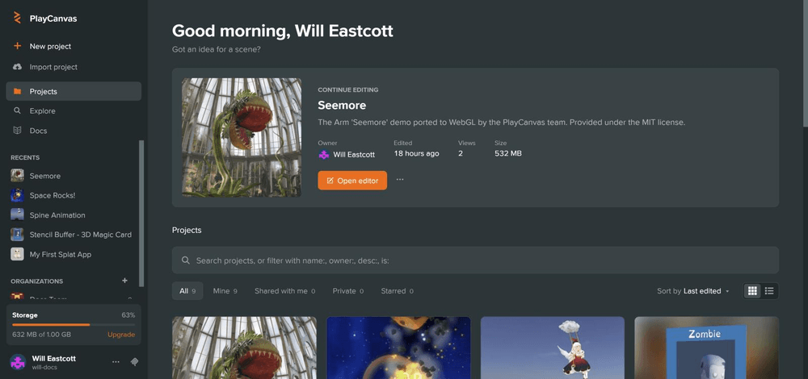

The resulting dialog box will show a few different options. There are starter kits available, but we don't want to load models or start a platform game.

1. We want to start small, so we will use a blank project — click on the _Blank Project_ option and enter a name for it (we are using "MDN Games demo").
2. Enter a description if you want — it is optional.
3. Click _Create project_ to have it created.

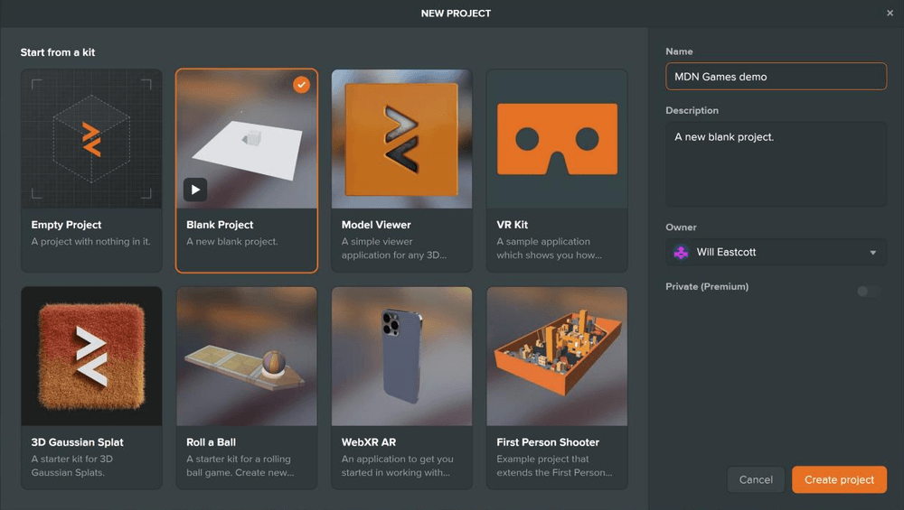

Once the project is ready, click _Open project_ in the confirmation that appears. Your new project opens in the online PlayCanvas editor in a new browser tab, which is where we'll create our scene.

## Creating the scene

Here's how the scene looks initially in the editor:

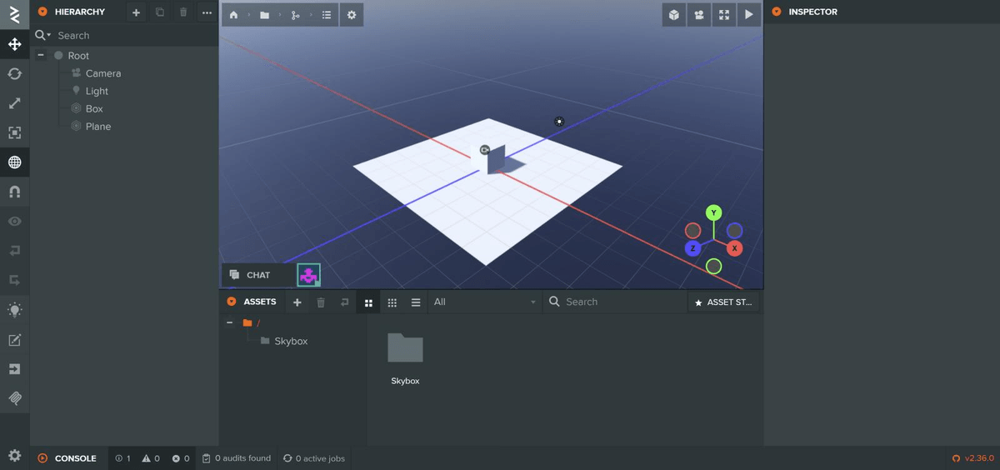

Even though it's a blank new project we don't have to start entirely from scratch — the camera and directional light are prepared already, so you don't have to worry about them.
The scene also contains a box and a ground plane. We'll create our own shapes, so select the _Box_ and _Plane_ entities in the _Hierarchy_ panel (hold <kbd>Ctrl</kbd> (<kbd>Cmd</kbd> on macOS) to select both) and press <kbd>Delete</kbd> to remove them.

Now onto the creative part. To add an entity to the scene you have to click on the plus button located at the top of the _Hierarchy_ panel. When hovering over that button with your mouse the label will say "Add Entity" — that's exactly what we want to do. An Entity is any object used in the scene — it can be an object like a box, cylinder, or cone, but it can also be a camera, light, or sound source. After clicking the button you'll see a menu containing several entities to choose from. Go ahead and select _3D_ > _Box_ — it will be added to the scene.

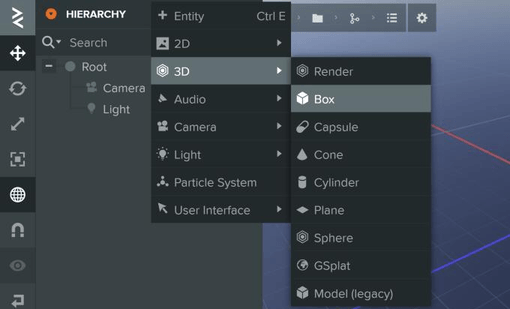

The box is created with default values — width, height and depth are set to 1, and it is placed in the middle of the scene. You can drag it around or apply new values in the _Inspector_ panel on the right.

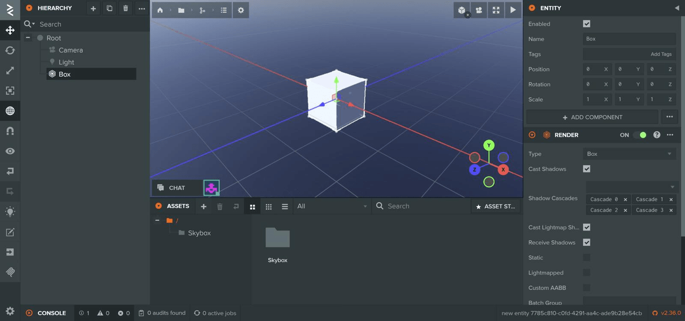

To add some colors to the scene we need a new material that will be used on our box. Click on the plus button in the _Assets_ panel, and click on the _Material_ option in the menu that appears to create a new material.

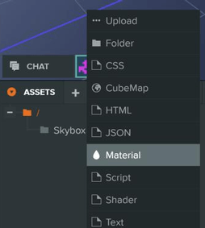

Your new material's properties should have appeared in the _Inspector_ panel on the right-hand side of the display (if not, click on your material in the _Assets_ panel). Now edit the _Name_ text field to give it a unique name (we've chosen _boxMaterial_). A unique name will help us remember what this material is for — we will add more later!

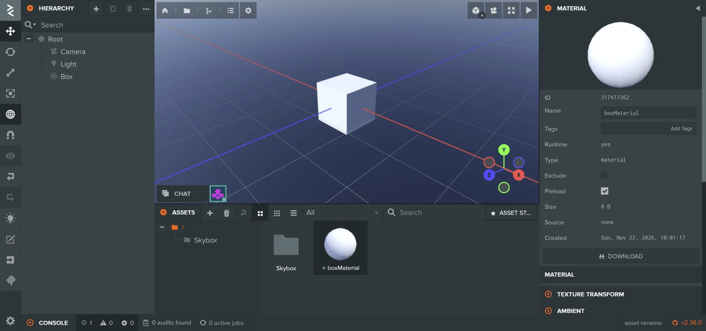

To change its color we'll use the _Diffuse_ section of the material's properties. Expand _Diffuse_, then select the colored box next to the _Color_ label — it will open a color picker. From here you can click your desired color or enter it in the bottom text field as a hex value. We've chosen a blue color with a hex value of `0095DD` — enter this code in the text field and press return for it to be accepted.

> [!NOTE]
> Yes, you read that right — you need to enter the hex value without the hash/pound symbol.

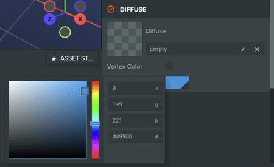

Now we can apply the colored material to the shape by clicking and dragging its thumbnail from the _Assets_ panel at the bottom of the screen onto the box in the scene. The box turns blue:

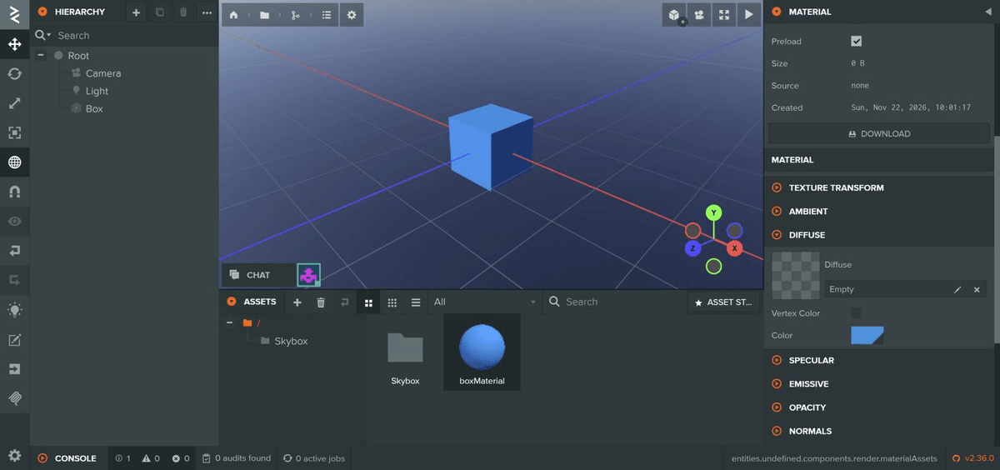

So, at this point we've created a blue box. Click on the _Box_ entity in the _Hierarchy_ panel to show its properties in the _Inspector_ — you'll see options for changing its position, rotation, and scale. Try applying the rotation values X: 10 and Y: 20.

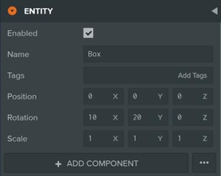

Now click on the _Launch_ button (the play icon) in the top right corner of the viewport to launch and render the scene — it will be opened in a separate browser tab.

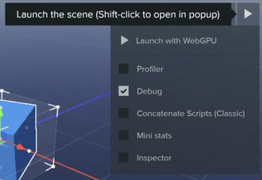

This looks great! Let's add more shapes to the scene to make it look more interesting.

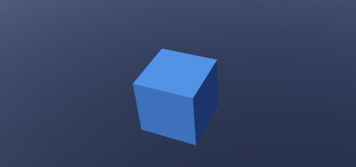

## Adding more shapes

To make way for more shapes, move the box to the left to make some room for the next shape. You can do this by giving it an X position value of -2.

Adding other shapes involves a very similar process to adding the box. Click on the _Root_ entity in the _Hierarchy_ panel (to make sure that the new shape appears in the root, and not as a child of the Box) then click on the _Add Entity_ (plus) button and select _3D_ > _Cylinder_ from the menu — it will add a new cylinder shape to the scene.

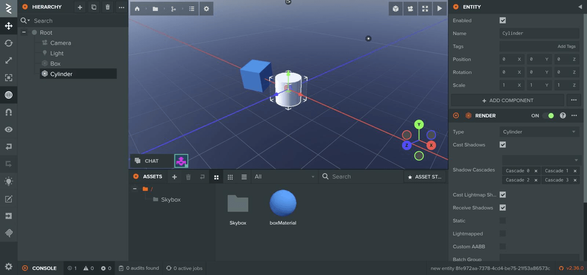

Now follow the same steps as we did before when coloring the cube:

- Create a new material using the plus button in the _Assets_ panel.
- Make sure the new material in the _Assets_ panel is selected, to show its properties in the _Inspector_.
- Give the material a new name, along the lines of `cylinderMaterial`.
- Expand _Diffuse_, then click the color picker — give it an orange color (we used `FF9500`).
- Drag and drop the `cylinderMaterial` thumbnail onto the cylinder object on the screen to apply that color.

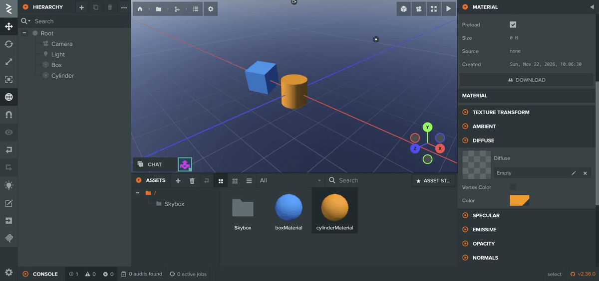

Follow the same approach again to add a cone to the scene, giving it a grayish color (we used `#EAEFF2`) and an X position value of 2. The cone appears in the same place as the cylinder, which makes it hard to click in the scene, so select _Cone_ in the _Hierarchy_ panel instead to show its properties in the _Inspector_. You should now have three shapes on your scene, something like this:

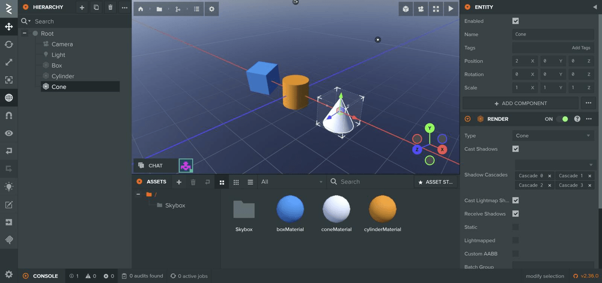

## Animating our scene

Animating 3D models might be considered an [advanced](https://developer.playcanvas.com/tutorials/anim-blending/) thing to do, but all we want to do is to control a few properties of a given object — we can use a script component to do that. Click on the plus button in the _Assets_ panel, select the _Script_ option, and name your new script file `boxAnimation.mjs`. The `.mjs` extension tells the editor to create the script as a JavaScript module, which is the recommended way to write PlayCanvas scripts.

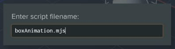

If you double click on it, you'll be moved to a code editor. The file already contains some boilerplate code: a `BoxAnimation` class that extends the engine's `Script` class, with a `scriptName` that the editor uses to identify it, and empty `initialize()` and `update()` methods. The most interesting part is the `update()` method, which is where we can put any code that we want repeated on every frame. Add the following line inside this method, to rotate the cube on every frame:

```js
update(dt) {
  this.entity.rotate(dt * 10, dt * 20, dt * 30);
}
```

`this.entity` refers to the object the script will be attached to (the box); using the `dt` variable, which contains the delta time passed since the previous frame, we can rotate the box by a different amount around all three axes.

Save the changes using the _Save File_ option in the code editor's _File_ menu (or by pressing <kbd>Ctrl</kbd>/<kbd>Cmd</kbd> + <kbd>S</kbd>), then return to the main editor tab. Here, follow these steps:

1. Be sure you have the box selected on the scene.
2. Click on _Add Component_, then _Script_ in the _Inspector_.
3. In the new _Script_ component, click _Add Script_ and choose `boxAnimation` from the list of available scripts — this will add the animation script to the box object.

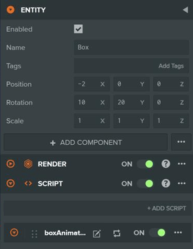

### The cylinder

Now we'll do the same steps for cylinder. First:

1. Create a new Script asset.
2. Name it `cylinderAnimation.mjs`.
3. Double click the script icon to launch the code editor.

This time, instead of rotating the object, we will scale it. For that, we'll need a timer to store the total amount of time passed since the start of the animation. Add this code to the `initialize()` method:

```js
this.timer = 0;
```

And those two lines to the `update()` method:

```js
this.timer += dt;
this.entity.setLocalScale(1, Math.abs(Math.sin(this.timer)), 1);
```

The `setLocalScale()` method applies the given values to the X, Y, and Z axes of the object. In our case we're modifying the scale of the cylinder on the Y axis, giving it the `Math.sin()` value of the timer, with `Math.abs()` applied to the result to make sure the value is always above zero (0-1; sin values are normally between -1 and 1). This gives us a nice scaling effect as a result.

Remember to add the `cylinderAnimation` script to the Cylinder object to apply the given animations.

### The cone

Time to play with the last object — the cone. Create a `coneAnimation.mjs` file and double click it to open it in the editor.

Next, add the following line to the `initialize()` method:

```js
this.timer = 0;
```

Let's move the cone up and down; to do this we will use the `setPosition()` method — add the code below to the `update()` method:

```js
this.timer += dt;
this.entity.setPosition(2, Math.sin(this.timer * 2), 0);
```

The position of the cone will be animated on each frame by being passed the `Math.sin()` value of the `timer` at each point in time — we have doubled the `this.timer` value to make it move higher.

Add the `coneAnimation` script to the cone object, as before.

## Test the demo out

Launch the demo to see the effects — all the shapes should animate. Congratulations, you've completed the tutorial!

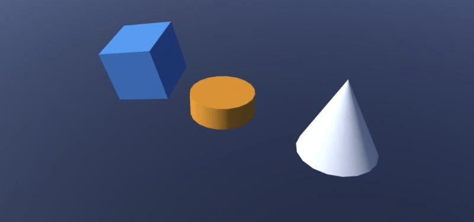

## Summary

Now you can check the [PlayCanvas engine](/en-US/docs/Games/Techniques/3D_on_the_web/Building_up_a_basic_demo_with_PlayCanvas/engine) article if you haven't seen it yet, go back to the [Building up a basic demo with PlayCanvas](/en-US/docs/Games/Techniques/3D_on_the_web/Building_up_a_basic_demo_with_PlayCanvas) page, or go back a level higher to the main [3D Games on the Web](/en-US/docs/Games/Techniques/3D_on_the_web) page.
