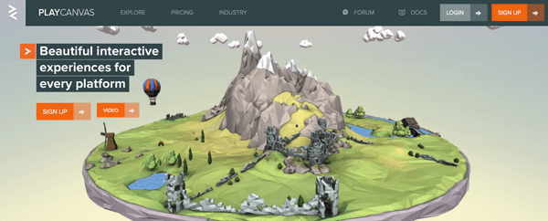
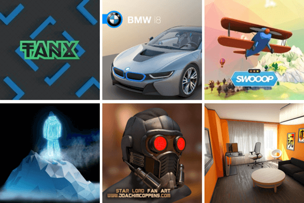

**PlayCanvas** is a popular 3D game engine for the web, originally created by Will Eastcott and Dave Evans. It renders with [WebGL 2](/en-US/docs/Web/API/WebGL_API) or [WebGPU](/en-US/docs/Web/API/WebGPU_API), and it is [open source on GitHub](https://github.com/playcanvas/engine) under the MIT license, with a browser-based [editor](https://developer.playcanvas.com/user-manual/editor/) and good [documentation](https://developer.playcanvas.com/). The editor is free to use for public projects, and there are also [paid plans](https://playcanvas.com/plans) that add private projects, more storage, and team management.

## Games and demos

PlayCanvas has a few well-known demos published that showcase its possibilities.

- [Tanx](https://tanx.io/) is a multiplayer tank game where you can drive your tank around, shooting at other players as you go.
- [Swooop](https://playcanv.as/p/JtL2iqIH) is a flying game where you pilot your plane around a magical island, collecting jewels and fuel as you go.
- Visualizations like the [Star-Lord](https://playcanv.as/p/SA7hVBLt/) and [BMW i8](https://playcanv.as/p/RqJJ9oU9) also take advantage of the engine and showcase what's possible.

> [!NOTE]
> Check out the list of [featured projects](https://playcanvas.com/explore) to find more examples, or browse the [engine examples](https://playcanvas.com/examples) to see individual features in action.

## Engine vs. editor

The engine itself can be used as a standard library by importing it from a CDN or installing it with npm, so you can start coding right away. PlayCanvas also offers [React](https://developer.playcanvas.com/user-manual/react/) and [Web Components](https://developer.playcanvas.com/user-manual/web-components/) wrappers around the engine, if you'd rather build scenes declaratively.

In addition, the PlayCanvas toolset comes with an online editor that you can use to drag and drop components onto the scene, and to edit it together with other people in real time — a great way to create games and other apps requiring scenes if you're more of a designer than a coder. Those approaches are different but work equally well regarding achieving end goals.

## PlayCanvas engine

Built for modern browsers, PlayCanvas is a fully-featured 3D game engine with resource loading, an entity and component system, advanced graphics features, a physics engine (built with [ammo.js](https://github.com/kripken/ammo.js/)), audio, and facilities to handle input from various devices (including gamepads). That's quite an impressive list of features — let's see some in action, check out the [Building up a basic demo with PlayCanvas engine](/en-US/docs/Games/Techniques/3D_on_the_web/Building_up_a_basic_demo_with_PlayCanvas/engine) for details.

## PlayCanvas editor

Instead of coding everything from the beginning you can also use the online editor. This can be a more pleasant working environment if you are not someone who likes to code. See the [Building up a basic demo with PlayCanvas editor](/en-US/docs/Games/Techniques/3D_on_the_web/Building_up_a_basic_demo_with_PlayCanvas/editor) for details.

## Summary

Of course, it depends on your approach — designers may favor the online editor while programmers will prefer having the full control over the coding environment and will probably use the engine's source files. The good thing is that you have a choice and can pick whatever tools suit you best.
