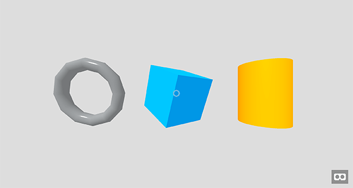

For rich gaming experiences on the web, the weapons of choice are the [WebGL API](/en-US/docs/Web/API/WebGL_API) or its successor, [WebGPU](/en-US/docs/Web/API/WebGPU_API), both of which can render hardware-accelerated 3D graphics on HTML {{htmlelement("canvas")}}.

## Explaining the basic 3D theory

3D theory centers around shapes represented in a 3D space, with a coordinate system to calculate their positions. See our [Explaining basic 3D theory](/en-US/docs/Games/Techniques/3D_on_the_web/Basic_theory) article for all the information you need.

## Advanced concepts

You can do a lot with WebGL and WebGPU. Key concepts to learn more about include shaders, collision detection, and virtual reality.

### Shaders

It's worth mentioning shaders, which are a separate story on their own. Shaders use the GLSL (for WebGL) and WGSL (for WebGPU) languages, with syntax similar to C, which is executed directly by the graphics pipeline. They can be split into vertex shaders and fragment shaders (or pixel shaders) — the former transforms shape positions to real 3D drawing coordinates, while the latter computes rendering colors and other attributes.

[GLSL Shaders](/en-US/docs/Games/Techniques/3D_on_the_web/GLSL_Shaders) provides some more information and a GLSL (WebGL) example.

### Collision detection

It's hard to imagine a game without collision detection — we always need to work out when something is hitting something else. See [3D collision detection](/en-US/docs/Games/Techniques/3D_collision_detection) for more information.

### WebXR

The concept of virtual reality (VR) is not new, but it's storming onto the web thanks to hardware advancements such as the [Meta Quest](https://www.meta.com/quest/), and the [WebXR API](/en-US/docs/Web/API/WebXR_Device_API) for capturing information from XR hardware and making it available for use in JavaScript applications. For more, read [WebXR — Virtual and Augmented Reality for the Web](/en-US/docs/Games/Techniques/3D_on_the_web/WebXR).

There's also the [A-Frame](https://aframe.io/) framework for facilitating the creation of Web VR experiences. See [Building up a basic demo with A-Frame](/en-US/docs/Games/Techniques/3D_on_the_web/Building_up_a_basic_demo_with_A-Frame) for more details.

## The rise of libraries and frameworks

Coding raw WebGL or WebGPU is fairly complex, but you'll want to get to grips with it in the long run, as your projects get more advanced. For real-world projects, you'll probably use a framework to speed up development and help you manage your code. Using a framework for 3D games also helps optimize performance: a lot is taken care of by the tools you use, so you can focus on building the game itself.

The most popular JavaScript 3D library is [Three.js](https://threejs.org/), a multipurpose tool that makes common 3D techniques simpler to implement. There are other popular game development libraries and frameworks worth checking out; [A-Frame](https://aframe.io/), [PlayCanvas](https://playcanvas.com/) and [Babylon.js](https://www.babylonjs.com/) are among the most recognizable ones with rich documentation, online editors and active communities.

### Building up a basic demo with A-Frame

A-Frame is a web framework for building 3D and VR experiences. Under the hood, it is a Three.js framework with a declarative entity-component pattern, meaning we can build scenes with just HTML. See the [Building up a basic demo with A-Frame](/en-US/docs/Games/Techniques/3D_on_the_web/Building_up_a_basic_demo_with_A-Frame) subpage for the step-by-step process of creating the demo.

### Building up a basic demo with Babylon.js

Babylon.js is one of the most popular 3D game engines used by developers. As with any other 3D library, it provides built-in functions to help you implement common 3D functionality more quickly. See the [Building up a basic demo with Babylon.js](/en-US/docs/Games/Techniques/3D_on_the_web/Building_up_a_basic_demo_with_Babylon.js) subpage for the basics of using Babylon.js, including setting up a development environment, structuring the necessary HTML, and writing the JavaScript code.

### Building up a basic demo with PlayCanvas

PlayCanvas is a popular 3D game engine for WebGL and WebGPU, open-sourced on GitHub, with an editor available online and good documentation. See the [Building up a basic demo with PlayCanvas](/en-US/docs/Games/Techniques/3D_on_the_web/Building_up_a_basic_demo_with_PlayCanvas) subpage for higher-level details, and further articles showing how to create demos using the PlayCanvas library and the online editor.

### Building up a basic demo with Three.js

Three.js, like any other library, gives you a huge advantage: instead of writing hundreds of lines of WebGL or WebGPU code to build anything interesting, you can use built-in helper functions to do it a lot faster. See [Building up a basic demo with Three.js](/en-US/docs/Games/Techniques/3D_on_the_web/Building_up_a_basic_demo_with_Three.js) for a basic tutorial.

### Other tools

[Unity](https://unity.com/) and [Unreal](https://www.unrealengine.com/) are very popular 3D engines, and both can export projects to WebGL or WebGPU, so you're free to use their tools and techniques to build games that will be exported to the web.

## Where to go next

This article only scratched the surface of what's possible with currently available technologies. You can build immersive, beautiful, performant 3D games on the Web using WebGL or WebGPU and related libraries and frameworks.

### Source code

You can find all the source code for this series [demos on GitHub](https://end3r.github.io/MDN-Games-3D/).

### APIs

- [Canvas API](/en-US/docs/Web/API/Canvas_API)
- [WebGL API](/en-US/docs/Web/API/WebGL_API)
- [WebGPU API](/en-US/docs/Web/API/WebGPU_API)
- [WebXR Device API](/en-US/docs/Web/API/WebXR_Device_API)

### Frameworks

- [Three.js](https://threejs.org/)
- [PlayCanvas](https://playcanvas.com/)
- [Babylon.js](https://www.babylonjs.com/)
- [A-Frame](https://aframe.io/)

### Tutorials

- [Building up a basic demo with Three.js](/en-US/docs/Games/Techniques/3D_on_the_web/Building_up_a_basic_demo_with_Three.js)
- [Building up a basic demo with PlayCanvas](/en-US/docs/Games/Techniques/3D_on_the_web/Building_up_a_basic_demo_with_PlayCanvas)
- [Building up a basic demo with Babylon.js](/en-US/docs/Games/Techniques/3D_on_the_web/Building_up_a_basic_demo_with_Babylon.js)
- [Building up a basic demo with A-Frame](/en-US/docs/Games/Techniques/3D_on_the_web/Building_up_a_basic_demo_with_A-Frame)
