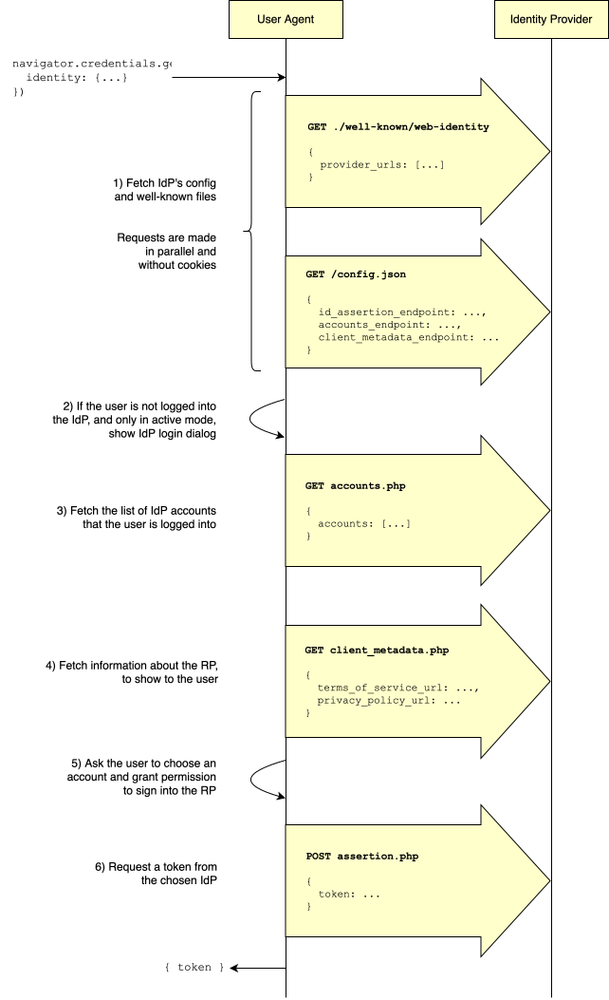

{{DefaultAPISidebar("FedCM API")}}

This article describes the process by which a {{glossary("Relying party", "relying party")}} (RP) can use the [Federated Credential Management (FedCM) API](/en-US/docs/Web/API/FedCM_API) to perform a federated sign-in using an {{glossary("Identity provider", "identity provider")}} (IdP).

## Setting up identity providers

Before an RP can use an IdP to sign in users, the RP must first select one or more IdPs that they want to use for federated sign-in. See [Choosing IdPs](/en-US/docs/Web/Security/Authentication/Federated_identity#choosing_idps) for a brief discussion of some of the considerations here.

The RP must then register with each of the IdPs it wants to use. The registration process is specific to an individual IdP and is outside the scope of the FedCM API. After registration, the IdP will issue a _client ID_ value to the RP, and the RP will be able to use this value to identify itself to the IdP.

The FedCM API manages the interactions between the user, the RP, and the IdP. However, it is agnostic about the specific protocol used, and so it doesn't determine the format or contents of all the objects that are exchanged between the RP and the IdP. A given IdP will implement a specific protocol, so as part of the registration process, the IdP will also explain to the RP exactly which arguments it expects to be given in a sign-in request, how the RP should use the objects that the IdP returns, and any other behavior it expects the RP to implement.

For example, the result of a successful call to {{domxref("CredentialsContainer.get", "navigator.credentials.get()")}} includes a `token` object. The FedCM API does not define the structure of the `token` object or what the RP should do with it: this depends entirely on the federated identity protocol that the IdP implements.

In the [FedCM for OAuth](https://github.com/aaronpk/oauth-fedcm-profile) profile, which describes how the [OpenID Connect (OIDC)](/en-US/docs/Web/Security/Authentication/Federated_identity#openid_connect) protocol could be implemented using FedCM, the token returned by `CredentialsContainer.get()` is an OAuth authorization code. The RP uses this code to retrieve the identity token from the IdP's token endpoint.

When an RP chooses to work with a particular IdP, the IdP will provide instructions for how to use the returned `token` value.

## Signing in

The FedCM API extends the [Credential Management API](/en-US/docs/Web/API/Credential_Management_API): to sign a user into a site using FedCM, the RP calls {{domxref("CredentialsContainer.get()", "navigator.credentials.get()")}}, passing in an {{domxref("IdentityCredentialRequestOptions")}} object. This object has three properties:

- [`context`](/en-US/docs/Web/API/IdentityCredentialRequestOptions#context): a string describing the context in which the RP is asking for a credential. In particular, it enables the RP to distinguish between a user _signing up for_ a new account, and a user _signing into_ an existing account. Context is important because in FedCM, the browser creates user interface elements to get the user's choices and ask their permission, so the context is used to show the user a prompt that is appropriate for the situation.

- [`mode`](/en-US/docs/Web/API/IdentityCredentialRequestOptions#mode): a string specifying whether the sign-in attempt must be triggered by a user action, such as a click on a "sign in" button, or whether it can be made automatically without a user action, for example on page load. A value of `"active"` indicates the first case, and `"passive"` indicates the second case. See [Active versus passive mode](#active_versus_passive_mode) for more details.

- [`providers`](/en-US/docs/Web/API/IdentityCredentialRequestOptions#mode): an array of objects, each containing information about an IdP that the RP can use for this sign-in attempt. Among other properties, this contains:
  - `configURL`: this tells the browser where it can find the configuration file for this IdP.
  - `clientId`: the value that identifies this RP to the IdP
  - `params`: any additional parameters that this IdP needs.

A typical request might look like this:

```js
async function signIn() {
  const identityCredential = await navigator.credentials.get({
    identity: {
      context: "signup",
      providers: [
        {
          configURL: "https://accounts.idp.example/config.json",
          clientId: "123456"
          params: {/* IdP-specific parameters */},
          loginHint: "user1@example.com",
        },
      ],
    },
  });
}
```

## FedCM sign-in flow

The FedCM sign-in flow starts with a call from the RP's front-end code to {{domxref("CredentialsContainer.get", "navigator.credentials.get()")}} and, if the call is successful, ends by returning a token which the RP can use to sign the user in.

The flow consists of a number of HTTP requests made between the browser and any IdPs listed in the call to `get()`, as well as some user interactions. All the requests include a {{httpheader("Sec-Fetch-Dest")}} header whose value is `webidentity`: the IdP must check that this header is included, as a defense against {{glossary("CSRF")}} attacks.

The following diagram shows the sequence of requests:



The first four steps are repeated for every IdP listed in the [`providers`](/en-US/docs/Web/API/IdentityCredentialRequestOptions#providers) option.

1. The first step is to fetch the IdP's configuration file. From the `configURL` provided for each IdP, the browser requests two files:
   - The [well-known file](/en-US/docs/Web/API/FedCM_API/IDP_integration#provide_a_well-known_file)
   - The [IdP config file](/en-US/docs/Web/API/FedCM_API/IDP_integration#provide_a_config_file_and_endpoints)

   These are both [`GET`](/en-US/docs/Web/HTTP/Reference/Methods/GET) requests, and don't have cookies or follow redirects. This effectively prevents IdPs from learning who made the request and which RP is attempting to connect.

   The IdP responds with the requested well-known file and `config.json` files. The browser checks that `configURL` is included in the list of valid config URLs inside the well-known file.

   The reason for this two-step process is to prevent the RP from using specially crafted config URL values to {{glossary("fingerprinting", "fingerprint")}} the user. See [Manifest fingerprinting](https://w3c-fedid.github.io/FedCM/#manifest-fingerprinting) for more details.

2. If the user is not currently [logged into the IdP](/en-US/docs/Web/API/FedCM_API/IDP_integration#update_login_status_using_the_login_status_api), and the request was made in [active mode](#active_versus_passive_mode), and only one IdP was listed in the `get()` parameters, then the browser will ask the user to log into the IdP.

3. If the user is logged into the IdP, the browser makes a GET request to the [accounts list endpoint](/en-US/docs/Web/API/FedCM_API/IDP_integration#the_accounts_list_endpoint), using the value of the [`accounts_endpoint`](/en-US/docs/Web/API/FedCM_API/IDP_integration#the_accounts_list_endpoint) property in the IdP config file. This request includes a cookie identifying the user that is signed in, but does not enable the IdP to learn which RP the user is trying to sign into.

   The response contains an array of objects. Each object represents an account that the user with this IdP, and includes an ID for this account and information such as the username and email address associated with the account. It also may include `approved_clients`, which is an array of client IDs, each of which identifies an RP account that the user has signed up with using this IdP account.

   > [!NOTE]
   > If the user is logged out of all the given IdPs, the `get()` call rejects with a `NetworkError` {{domxref("DOMException")}} and does not make a request to any IdP's accounts list endpoint. Note that there may be some delay in the rejection to avoid leaking IdP login status to the RP.

4. If the IdP config file contains a `client_metadata_endpoint` property, the browser makes a request to the [client metadata endpoint](/en-US/docs/Web/API/FedCM_API/IDP_integration#the_client_metadata_endpoint) to fetch URLs for the RP's terms of service and privacy policy pages. This is a `GET` request sent without cookies but with the `clientId` passed into the `get()` call as a parameter.

5. The browser uses the information obtained by the previous two sets of requests to create the UI asking the user to choose an IdP (if the user is logged into more than one) and an account to sign into the RP with. The UI also asks the user for permission to sign in to the RP using their chosen federated IdP account.

   If the user is signed into the IdP but does not already have an account with the RP — that is, the `approved_clients` array is empty — then the UI presented to the user will include **disclosure text**. This is additional information provided by the browser to explain to the user that they will be asked to create a new account on the RP, using the identity they have registered with the IdP. The disclosure text typically takes the form of a dialog including an option labeled "Continue as..." followed by the name under which the user is registered with the IdP. The disclosure text may also include links to the RP's terms of service and privacy policy, if these were given in the [client metadata endpoint](/en-US/docs/Web/API/FedCM_API/IDP_integration#the_client_metadata_endpoint) for this RP. If the user agrees to continue, they will then be asked to create an account on the RP using their IdP identity.

   If the user is signed into the IdP, does have an account with the current RP, and has logged in with it in the current browser instance, they may be able to [auto-reauthenticate](#auto-reauthentication). In this case the user will be signed in automatically without requiring any interaction.

6. Finally, if the user granted permission to do so, the browser makes a POST request to the [ID assertion endpoint](/en-US/docs/Web/API/FedCM_API/IDP_integration#the_id_assertion_endpoint) of the selected IdP to request a token for the selected RP account. The request includes cookies.

   The IdP checks that the ID for the IdP account that the user selected matches the ID for the account that is already signed in, and that the `Origin` header matches the origin of the RP, which will have been registered in advance with the IdP. If everything looks good, it responds with the requested token.

   The `get()` promise resolves with an {{domxref("IdentityCredential")}} object, which contains the token, and the RP can use the token to sign the user in.

   If the POST request fails, an error payload is returned as explained in [ID assertion error responses](/en-US/docs/Web/API/FedCM_API/IDP_integration#id_assertion_error_responses) and the promise returned by `get()` will reject with the error.

## Active versus passive mode

There are two different UI modes the browser can provide to an RP user when they sign in using the FedCM API: _active_ and _passive_ mode. Which mode is used for sign-in is controlled by the [`mode`](/en-US/docs/Web/API/IdentityCredentialRequestOptions#mode) option of the `identity` object:

```js
async function signIn() {
  const identityCredential = await navigator.credentials.get({
    identity: {
      mode: active,
      providers: [
        {
          configURL: "https://accounts.idp.example/config.json",
          clientId: "********",
        },
      ],
    },
  });
}
```

Active mode can only be used if the request has {{glossary("transient activation")}}: that is, it must be made in response to a user action (such as clicking a "Sign in" button). Active mode can also only be used with a single item in the `providers` array: that is, it only works if the RP specifies a single IdP to sign in with.

In active mode, if the user is not already signed into the IdP, then the browser will ask the user if they want to sign into the IdP: if they do, then the flow continues with this IdP.

Because the RP can only specify a single IdP in active mode, then if the RP wants to support multiple IdPs in active mode, they must present separate sign-in buttons for each IdP (the [NASCAR problem](https://indieweb.org/NASCAR_problem)).

In passive mode, the RP can list multiple IdPs in `providers`. The browser will exclude any IdPs that the user is not signed into, and will present the user with a dialog asking them which of these IdPs they want to use. If the user is not signed into any IdPs, then the request will fail. Passive mode is appropriate when the sign-in process may be started without any explicit user action: for example, on page load.

Passive mode is the default.

## Auto-reauthentication

FedCM auto-reauthentication lets users reauthenticate automatically when they try to sign in to an RP again after their initial authentication using FedCM. "Initial authentication" refers to when the user creates an account or signs into the RP's website via the FedCM sign-in dialog for the first time on the RP site, on the same browser instance.

After the initial authentication, auto-reauthentication can be used to sign into the RP website again automatically, without needing to show the user a "Continue as..." confirmation prompt. If the user has recently granted permission to allow federated sign-in to occur with a particular account, there's no privacy or security benefit to immediately enforcing another explicit user confirmation.

Auto-reauthentication behavior is controlled by the [`mediation`](/en-US/docs/Web/API/CredentialsContainer/get#mediation) option in the `get()` call:

```js
async function signIn() {
  const identityCredential = await navigator.credentials.get({
    identity: {
      providers: [
        {
          configURL: "https://accounts.idp.example/config.json",
          clientId: "********",
        },
      ],
    },
    mediation: "optional", // this is the default
  });

  // isAutoSelected is true if auto-reauthentication occurred.
  const isAutoSelected = identityCredential.isAutoSelected;
}
```

Auto-reauthentication can occur if `mediation` is set to `optional` or `silent`.

With these `mediation` options, auto-reauthentication will occur under the following conditions:

- FedCM is available to use. For example, the user has not disabled FedCM either globally or in the RP's settings.
- The user has only used one account to sign into the RP website on this browser via FedCM. If accounts exist for multiple IdPs, the user won't be automatically re-authenticated.
- The user is signed into the IdP with that account.
- The user already has an account with the RP, which uses their IdP-managed identity. This condition is indicated using the [`approved_clients`](/en-US/docs/Web/API/FedCM_API/IDP_integration#approved_clients) array contained in the JSON returned from the [accounts list endpoint](/en-US/docs/Web/API/FedCM_API/IDP_integration#the_accounts_list_endpoint).
- Auto-reauthentication didn't happen within the last 10 minutes. This restriction is put into place to stop users being auto-reauthenticated immediately after they sign out — which would make for a pretty confusing user experience.
- The RP hasn't called {{domxref("CredentialsContainer.preventSilentAccess", "preventSilentAccess()")}} after the previous sign in. This can be used by an RP to explicitly disable auto-reauthentication if desired.
- The UI mode is [passive](#active_versus_passive_mode).

When these conditions are met, an attempt to automatically reauthenticate the user starts as soon as the `get()` is invoked. If auto-reauthentication is successful, the user will log into the RP site again, without being shown a confirmation prompt, using the same IdP account and validated token as they did before.

If auto-reauthentication fails, the behavior depends on the `mediation` value that was chosen:

- `optional`: the user _will_ be shown the dialog box and asked for confirmation again. As a result, this option tends to make sense to use on a page where a user journey is not in mid-flow, such an RP sign-in page.
- `silent`: The `get()` promise will reject and the developer will need to handle guiding the user back to the sign-in page to start the process again. This option makes sense on pages where a user journey is in flow and you need to keep them signed in until completion, for example the pages of a checkout flow on an e-commerce website.

> [!NOTE]
> The {{domxref("IdentityCredential.isAutoSelected")}} property provides an indication of whether the federated sign-in was carried out using auto-reauthentication. This is helpful to evaluate the API performance and improve UX accordingly. Also, when it's unavailable, the user may be prompted to sign in with explicit user mediation, which is a `get()` call with `mediation: required`.

## Disconnecting a federated sign-in

The RP may disconnect a specified federated sign-in account from the associated IdP by invoking {{domxref("IdentityCredential.disconnect_static", "IdentityCredential.disconnect()")}}. This function can be called from a top-level RP frame.

```js
IdentityCredential.disconnect({
  configURL: "https://idp.example.com/config.json",
  clientId: "rp123",
  accountHint: "account456",
});
```

For a `disconnect()` call to work, the IdP must include a [`disconnect_endpoint`](/en-US/docs/Web/API/FedCM_API/IDP_integration#disconnect_endpoint) in its config file. See [The disconnect endpoint](/en-US/docs/Web/API/FedCM_API/IDP_integration#the_disconnect_endpoint) for more details of the underlying HTTP communication.

## See also

- [Federated Credential Management API](https://developer.chrome.com/docs/identity/fedcm/overview) on developer.chrome.com (2023)
