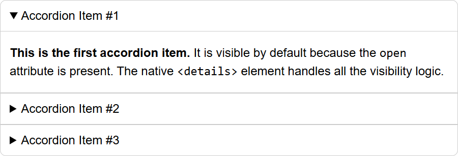

An accordion divides long-form content into a series of disclosure widgets. This helps users focus on currently relevant details while preserving the page layout.



## Requirements

Create an accordion for long and/or dense material, with each relevant section separated into individual disclosure widgets.

## Recipe

The {{HTMLElement("details")}} element along with its [`name`](/en-US/docs/Web/HTML/Reference/Elements/details#name) attribute can be used to create a working accordion.

```html live-sample___accordion-example
<article class="accordion">
  <!-- First item -->
  <details class="accordion-item" name="myAccordion" open>
    <summary class="accordion-header">
      Accordion Item #1
    </summary>
    <div class="accordion-body">
      <p><strong>This is the first accordion item.</strong> It is visible by default because the <code>open</code> attribute is present. The native <code>&lt;details&gt;</code> element handles all the visibility logic.</p>
    </div>
  </details>
  <!-- Second item -->
  <details class="accordion-item" name="myAccordion">
    <summary class="accordion-header">
      Accordion Item #2
    </summary>
    <div class="accordion-body">
      <p><strong>This is the second accordion item.</strong> The <code>name</code> attribute groups this with other accordion items. It also ensures that all other accordion items remain closed whenever this item is open.</p>
    </div>
  </details>
  <!-- Third item -->
  <details class="accordion-item" name="myAccordion">
    <summary class="accordion-header">
      Accordion Item #3
    </summary>
    <div class="accordion-body">
      <p><strong>This is the third accordion item.</strong> Such unique behavior is achievable using only HTML and CSS! Just keep grouping the <code>&lt;details&gt;</code> element and <code>name</code> attribute together until you get what you want!</p>
    </div>
  </details>
</article>
```

```css live-sample___accordion-example
body {
  font-family: sans-serif;
  font-size: 1rem;
  line-height: 1.5;
}

.accordion .accordion-item {
  border: 1px solid #ccc;
}

.accordion .accordion-item:first-of-type {
  border-top-left-radius: 0.5rem;
  border-top-right-radius: 0.5rem;
}
.accordion .accordion-item:last-of-type {
  border-bottom-left-radius: 0.5rem;
  border-bottom-right-radius: 0.5rem;
}

.accordion-item > .accordion-header {
  width: 100%;
  padding: 0.5rem 0.75rem;
}
.accordion-item[open] > .accordion-header {
  border-bottom: 1px solid #ccc;
}

.accordion-item > .accordion-body {
  padding-left: 0.75rem;
  padding-right: 0.75rem;
}
```

{{EmbedLiveSample("accordion-example", "", "250px")}}

## Choices made

To stylize the accordion headers, we apply [border styles](/en-US/docs/Web/CSS/Guides/Borders_and_box_decorations) and padding to each {{HTMLElement("summary")}} element.

## See also

- [`<details>` element](/en-US/docs/Web/HTML/Reference/Elements/details)
- [`::details-content`](/en-US/docs/Web/CSS/Reference/Selectors/::details-content)
