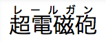
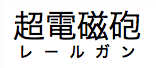

The **`ruby-position`** [CSS](/en-US/docs/Web/CSS) property defines the position of a ruby element relative to its base element. It can be positioned over the element (`over`), under it (`under`), or to the right (`inter-character`).

{{InteractiveExample("CSS Demo: ruby-position")}}

```css interactive-example-choice
ruby-position: over;
```

```css interactive-example-choice
ruby-position: under;
```

```html interactive-example
<section id="default-example">
  <ruby id="example-element"> 明日 <rp>(</rp><rt>Ashita</rt><rp>)</rp> </ruby>
</section>
```

```css interactive-example
#example-element {
  font-size: 2em;
}
```

## Syntax

```css
/* Keyword values */
ruby-position: over;
ruby-position: under;
ruby-position: alternate;
ruby-position: alternate over;
ruby-position: alternate under;
ruby-position: inter-character;

/* Global values */
ruby-position: inherit;
ruby-position: initial;
ruby-position: revert;
ruby-position: revert-layer;
ruby-position: unset;
```

### Values

This property is specified as one of the following keyword values:

- `over`
  - : 
    Is a keyword indicating that the ruby has to be placed over the main text for horizontal scripts and right to it for vertical scripts.
- `under`
  - : 
    Is a keyword indicating that the ruby has to be placed under the main text for horizontal scripts and left to it for vertical scripts.
- `alternate`
  - : Is a keyword indicating that the ruby alternates between over and under, when there are multiple levels of annotation.
- `inter-character`
  - : Is a keyword indicating that the ruby annotation is placed to the right of the base text characters. This value is intended for bopomofo (zhuyin fuhao) ruby.

## Formal definition

{{cssinfo}}

## Formal syntax

{{csssyntax}}

## Examples

### Ruby positioned over the text

#### HTML

```html
<ruby>
  <rb>超電磁砲</rb>
  <rp>（</rp><rt>レールガン</rt><rp>）</rp>
</ruby>
```

#### CSS

```css
ruby {
  ruby-position: over;
}
```

#### Result

{{EmbedLiveSample("Ruby_positioned_over_the_text", 100, 40)}}

### Ruby positioned under the text

#### HTML

```html
<ruby>
  <rb>超電磁砲</rb>
  <rp>（</rp><rt>レールガン</rt><rp>）</rp>
</ruby>
```

#### CSS

```css
ruby {
  ruby-position: under;
}
```

#### Result

{{EmbedLiveSample("Ruby_positioned_under_the_text", 100, 40)}}

### Ruby alternate

#### HTML

```html
<ruby>
  <rb>A</rb><rb>B</rb><rb>C</rb>
  <rtc>Above</rtc>
  <rtc>Below</rtc>
</ruby>
```

#### CSS

```css
ruby {
  ruby-position: alternate; /* this is also the initial value */
}
```

#### Result

{{EmbedLiveSample("Ruby_alternate", 100, 40)}}

### Ruby positioned between characters

This example uses `inter-character` to place bopomofo (zhuyin fuhao) annotations to the right of each base character.

> [!NOTE]
> Browser support for `inter-character` is limited. See [Browser compatibility](#browser_compatibility).

#### HTML

```html
<ruby>
  注<rp>(</rp><rt>ㄓㄨˋ</rt><rp>)</rp>音<rp>(</rp><rt>ㄧㄣ</rt><rp>)</rp>
</ruby>
```

#### CSS

```css
ruby {
  ruby-position: inter-character;
}
```

#### Result

{{EmbedLiveSample("Ruby_positioned_between_characters", 100, 60)}}

## Specifications

{{Specifications}}

## Browser compatibility

{{Compat}}

## See also

- {{HTMLElement("ruby")}}, {{HTMLElement("rt")}}, {{HTMLElement("rp")}}, and {{HTMLElement("rtc")}} HTML elements
- {{cssxref("ruby-align")}}
- [CSS ruby layout](/en-US/docs/Web/CSS/Guides/Ruby_layout) module
- [Positioning of zhuyin](https://www.w3.org/TR/clreq/#positioning_of_zhuyin) in Requirements for Chinese Text Layout
