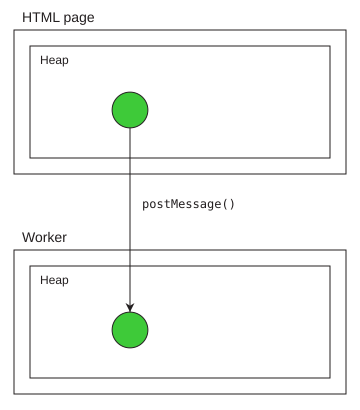
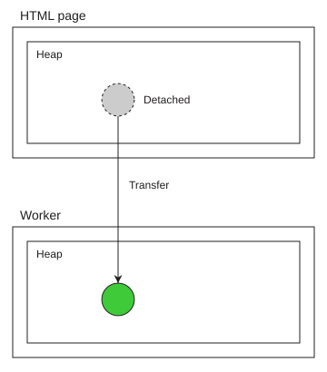
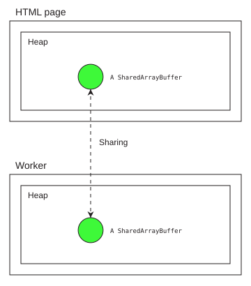

**Agents** is the JavaScript formal terminology for describing autonomous JavaScript executors. Most JavaScript you write gets executed in a single thread, but you may create more threads with specific platform APIs such as [web workers](/en-US/docs/Web/API/Web_Workers_API).

This guide explains general computer science concepts related to thread coordination and how JavaScript implements them. It also introduces the APIs for enabling cross-thread communication: {{domxref("Worker/postMessage", "postMessage()")}}, {{jsxref("SharedArrayBuffer")}}, and {{jsxref("Atomics")}}.

It is recommended to understand [Typed arrays](/en-US/docs/Web/JavaScript/Guide/Typed_arrays) before reading this. Afterwards, you can continue with the [Execution model](/en-US/docs/Web/JavaScript/Reference/Execution_model) reference to dive into the technical details.

> [!NOTE]
> In this article, we will use "thread" and "agent" interchangeably. An agent is a JavaScript engine abstraction, while a thread is an implementation detail; an agent may or may not run in a separate operating system thread. Technically, we should have used "agents" everywhere because you can only interact with agents in JavaScript, but when talking about general computer science concepts like locks, it's much more natural to use "threads".
>
> Also, this guide has nothing to do with [AI agents](https://en.wikipedia.org/wiki/AI_agent).

## Communication between two agents

The JavaScript language spec does not provide APIs for creating agents, getting a reference to another agent, or exchanging data between them. Although the concept of "workers" exists in both the web and in Node.js, their APIs are largely distinct. This guide uses [web workers](/en-US/docs/Web/API/Web_Workers_API).

### Creating agents

A parent agent creates and holds a reference to a child agent using the {{domxref("Worker/Worker", "Worker()")}} constructor:

```js
// -- main.js --
const worker = new Worker("./worker.js", { type: "module" });
```

The parent agent can be a window or another worker. For example, to run this example in a browser, you can reference `main.js` in an HTML file:

```html
<script src="main.js" type="module"></script>
```

### Communication via messages

Two agents communicate using _messages_. Messages are sent over _message channels_. The parent agent (`main.js` here) and its child agent (`worker.js` here) have a message channel by default, which routes to their default ports:

- `main.js` sends messages using {{domxref("Worker/postMessage", "worker.postMessage()")}}, and receives messages using the {{domxref("Worker/message_event", "message")}} event on the `worker` object.
- `worker.js` sends messages using {{domxref("DedicatedWorkerGlobalScope/postMessage", "self.postMessage()")}}, and receives messages using the {{domxref("DedicatedWorkerGlobalScope/message_event", "message")}} event on `self`.

However, this is limited to communication between the creator and the agent it creates. When you want any two agents to communicate, you need to use a dedicated {{domxref("MessageChannel")}}. You pass one of its {{domxref("MessagePort")}} objects to the worker over the default channel, and then exclusively use that port:

```js
// -- main.js --
const worker = new Worker("./worker.js", { type: "module" });
const { port1, port2 } = new MessageChannel();

// We'll explain the [port2] parameter soon
worker.postMessage({ hereIsYourPort: port2 }, [port2]);

// Mark the port as ready for receiving messages
port1.start();
```

```js
// -- worker.js --
// Use top-level await (only available inside modules) so code following it
// only evaluates when the port is received
const port = await new Promise((resolve, reject) => {
  self.addEventListener(
    "message",
    (e) => {
      const port = e.data.hereIsYourPort;
      if (!(port instanceof MessagePort)) {
        reject(new Error("I'm expecting a dedicated port"));
        return;
      }
      resolve(port);
    },
    { once: true },
  );
});

// Mark the port as ready for receiving messages
port.start();
```

> [!NOTE]
> In all subsequent examples, we'll assume that these lines exist at the top of `main.js` and `worker.js`. We won't repeat them.

Now, each agent can call {{domxref("MessagePort/postMessage", "postMessage()")}} and listen for {{domxref("MessagePort/message_event", "message")}} events on the `MessagePort` object.

Using message channels, you can also connect two agents that aren't in a parent-child relationship, such as two workers created by the same thread:

```js
const { port1, port2 } = new MessageChannel();
const worker1 = new Worker("./worker1.js", { type: "module" });
const worker2 = new Worker("./worker2.js", { type: "module" });

worker1.postMessage({ hereIsYourPort: port1 }, [port1]);
worker2.postMessage({ hereIsYourPort: port2 }, [port2]);
```

As a practical example, we implement a number-guessing game. `main.js` defines a secret number, and `worker.js` tries to guess it. Each time, `main.js` tells `worker.js` whether the guess is correct, too low, or too high, and the worker adjusts its guess. Here's how `main.js` can receive guesses from the worker using {{domxref("MessageEvent.data")}}, and provide feedback using `port1.postMessage()`:

```js
// -- main.js --
const secretNumber = 63;

port1.addEventListener("message", (e) => {
  const workerGuess = e.data;
  console.log("Worker guessed:", workerGuess);
  if (workerGuess < secretNumber) {
    port1.postMessage("Too low");
  } else if (workerGuess > secretNumber) {
    port1.postMessage("Too high");
  } else {
    port1.postMessage("Correct");
    console.log("Worker successfully guessed the secret number!");
  }
});
```

And here's how the worker can submit guesses to `main.js` and adjust based on the feedback from it:

```js
// -- worker.js --
let low = 0;
let high = 100;
let lastGuess = Math.floor((low + high) / 2);

// First guess submitted immediately after initialization
port.postMessage(lastGuess);
port.addEventListener("message", (e) => {
  const feedback = e.data;
  if (feedback === "Correct") {
    console.log("Yay");
    return;
  }
  if (feedback === "Too low") {
    low = lastGuess + 1;
  } else if (feedback === "Too high") {
    high = lastGuess - 1;
  }
  if (low > high) {
    throw new Error(
      "Sorry, the feedback from main.js is inconsistent and I suspect main is cheating",
    );
  }
  lastGuess = Math.floor((low + high) / 2);
  port.postMessage(lastGuess);
});

port.start();
```

If you run this in a browser, both the worker and the main thread will output to the same DevTools console, so you will see the output as:

```plain
Worker guessed: 50                              main.js
Worker guessed: 75                              main.js
Worker guessed: 62                              main.js
Worker guessed: 68                              main.js
Worker guessed: 65                              main.js
Worker guessed: 63                              main.js
Worker successfully guessed the secret number!  main.js
Yay                                             worker.js
```

### Sending messages by copying or transferring

You can pass many kinds of JavaScript values to `postMessage`. In the number-guessing example, we pass numbers for guesses, strings for feedback, and objects for the `MessagePort`. By default, each agent has its own [memory space](/en-US/docs/Web/JavaScript/Reference/Execution_model#agent_execution_model), so when an object is sent from one heap to another, a copy of it is created in the target heap. The copy uses the [structured clone algorithm](/en-US/docs/Web/API/Web_Workers_API/Structured_clone_algorithm), which only supports a fixed set of data types. When you attempt to copy an unsupported object, a {{domxref("DOMException")}} is thrown.



Copying an object allows the sender and the recipient to independently manipulate the object without affecting the other. The downside is that the object is re-constructed in the recipient's scope, which means:

- It's not tethered to the original creator, so {{domxref("MessagePort")}} can't work (indeed, if you read the list of [serializable objects](/en-US/docs/Web/API/Web_Workers_API/Structured_clone_algorithm#supported_types), you can see that `MessagePort` is not listed here).
- There are two copies of the same data, which increases memory usage.

To solve these problems, instead of copying objects, you can pass them by _transferring_ instead. Transferring an object uses a slightly different algorithm for constructing it in the target realm, and marks it as _detached_ in the source realm. The source object still exists, but its transferred resource is now available through the new object in the target realm:



To transfer an object, you still pass it (or other objects containing it) to `postMessage()`. The second parameter of `postMessage()` takes a list of objects inside the message that should be transferred instead of copied. This explains the following line in the number guessing game:

```js
worker.postMessage({ hereIsYourPort: port2 }, [port2]);
```

The whole object `{ hereIsYourPort: port2 }` is copied as usual and can be used in both agents, though it isn't assigned to a variable in the sender, so it will be immediately dropped over there. The `port2` resource is taken over by the new object in the worker agent, while the source instance is marked as detached. The effects of detachment depend on the object type, but generally operations either throw an error or do nothing. For a `MessagePort`, the original object loses its connection to the other port.

Other than `MessagePort`, another widely-used transferable object is {{jsxref("ArrayBuffer")}}, which happens to be both copyable and transferable. When an `ArrayBuffer` is copied, the source and recipient each hold an independent copy, and mutations on one side do not affect the other. When an `ArrayBuffer` is transferred, it is again marked as _detached_. A detached array buffer still exists as an object, but no longer provides access to the underlying memory. This means that:

- {{jsxref("ArrayBuffer/byteLength", "byteLength")}} becomes 0 (in both the buffer and the associated typed array views).
- Methods, such as {{jsxref("ArrayBuffer/resize", "resize()")}} and {{jsxref("ArrayBuffer/slice", "slice()")}}, throw a {{jsxref("TypeError")}} when invoked. The associated typed array views' methods also throw a `TypeError`.

You can check whether an `ArrayBuffer` is detached via its {{jsxref("ArrayBuffer/detached", "detached")}} property.

In pure JavaScript, you can also transfer the ownership of memory from one `ArrayBuffer` to another using its {{jsxref("ArrayBuffer/transfer", "transfer()")}} or {{jsxref("ArrayBuffer/transferToFixedLength", "transferToFixedLength()")}} method.

```js
const buffer1 = new ArrayBuffer(1024);
console.log(buffer1.detached); // false
console.log(buffer1.byteLength); // 1024

const buffer2 = buffer1.transfer();
console.log(buffer1.detached); // true
console.log(buffer1.byteLength); // 0
console.log(buffer2.byteLength); // 1024
```

## Sharing memory with SharedArrayBuffer

Other than copying and transferring, there's a third model of data passing: _sharing_. In sharing, both sides hold an object that shares the underlying memory. Memory sharing is available only to the {{jsxref("SharedArrayBuffer")}} object. The sender and recipient still hold distinct instances of the `SharedArrayBuffer` object, but they represent pointers to the same memory span and mutations on one side are visible to the other side.



### Enabling shared memory

Memory sharing isn't inherently risky; however, it allows implementing a high-precision clock (we won't go into the details here), which was revealed to enable [Spectre](<https://en.wikipedia.org/wiki/Spectre_(security_vulnerability)>) attacks. In response to this, browsers restrict shared memory access to [cross-origin isolated](/en-US/docs/Web/API/Window/crossOriginIsolated) websites only.

> [!NOTE]
> If you are using Node.js for this tutorial (which means you had been adapting the previous examples to Node-specific APIs), you can ignore this section, because shared memory is available by default.

If you are using a local HTTP server to experiment with these examples, you must make your website cross-origin isolated, for example by sending the following headers:

```http
Cross-Origin-Embedder-Policy: require-corp
Cross-Origin-Opener-Policy: same-origin
```

After you do this, you can perform the following checks to confirm that shared memory is enabled:

```js
console.log(window.crossOriginIsolated); // true
console.log("SharedArrayBuffer" in window); // true
```

Now you can share memory, but only within an [agent cluster](/en-US/docs/Web/JavaScript/Reference/Execution_model#agent_clusters_and_memory_sharing)—you can't share memory with agents outside of its cluster, even when they have a message channel. A window and its dedicated worker are in the same cluster, so our examples will work fine.

### Using a shared buffer

The `SharedArrayBuffer` (SAB) interface is mostly identical to `ArrayBuffer`. You can construct a `SharedArrayBuffer`, which allocates the specified number of bytes.

```js
const sab = new SharedArrayBuffer(1024);
```

You can read and write the memory contents by constructing a [view](/en-US/docs/Web/JavaScript/Guide/Typed_arrays#views), such as a {{jsxref("Int8Array")}}.

```js
const int8 = new Int8Array(sab);
int8[0] = 63;
```

You can create a [slice](/en-US/docs/Web/JavaScript/Reference/Global_Objects/SharedArrayBuffer/slice) of the SAB, which allocates a new shared memory span and copies its contents.

```js
const sab2 = sab.slice();
// Entire sab is copied
const int82 = new Int8Array(sab2);
console.log(int82[0]); // 63
```

There are several differences between `SharedArrayBuffer` and `ArrayBuffer` (other than memory-sharing behavior, of course):

- Resizable SABs can only be _grown_, while normal resizable buffers can both be grown and shrunk.
- SABs cannot be transferred/detached.

To create a resizable/growable SAB, pass the `maxByteLength` option specifying the maximum length it's allowed to grow to. Then, you can use [`grow()`](/en-US/docs/Web/JavaScript/Reference/Global_Objects/SharedArrayBuffer/grow).

```js
const sabResizable = new SharedArrayBuffer(1024, { maxByteLength: 2048 });
console.log(sabResizable.byteLength); // 1024

sabResizable.grow(2000);
console.log(sabResizable.byteLength); // 2000
```

### Posting SharedArrayBuffers

`SharedArrayBuffer` objects are always shared when passed to `postMessage()` (as long as the security requirements are met); no extra options are necessary. Both sides can mutate this memory span and observe the other side's mutations. You can also pass a view of a `SharedArrayBuffer` directly—the view and the `buffer` object are both copied, but the underlying memory span is still shared.

In the following examples, we'll share a buffer between `main.js` and `worker.js` together with the message port. Replace the line in `main.js`:

```js
worker.postMessage({ hereIsYourPort: port2 }, [port2]);
```

With:

```js
const sab = new SharedArrayBuffer(1024);
worker.postMessage({ hereIsYourPort: port2, andHereIsOurSAB: sab }, [port2]);
```

And inside `worker.js`, replace the initial reception code with:

```js
const { port, sab } = await new Promise((resolve, reject) => {
  self.addEventListener(
    "message",
    (e) => {
      const port = e.data.hereIsYourPort;
      if (!(port instanceof MessagePort)) {
        reject(new Error("I'm expecting a dedicated port"));
        return;
      }
      const sab = e.data.andHereIsOurSAB;
      if (!(sab instanceof SharedArrayBuffer)) {
        reject(new Error("I'm expecting a shared array buffer"));
        return;
      }
      resolve({ port, sab });
    },
    { once: true },
  );
});
```

To verify that this setup works, try coordinating a short write-read exchange using a message. The worker immediately updates the `SharedArrayBuffer` and posts a message to the main thread. The main thread receives that message and reads the new value. We'll talk about more efficient communications later.

```js
// -- main.js --
const int8 = new Int8Array(sab);

port1.addEventListener("message", (e) => {
  console.log(int8[0]); // 63
});
```

```js
// -- worker.js --
const int8 = new Int8Array(sab);
int8[0] = 63;
port.postMessage("I've modified the memory. Please check");
```

## Accessing shared memory with Atomics

In the example above, we use a message to force the following order:

1. Worker writes to memory
2. Worker posts message
3. Main agent receives message and runs event listener
4. Main agent reads memory

The problem with event-based coordination is that events are asynchronous: the time between steps 2 and 3 is dependent on the browser's event loop. In this case, you might as well pass values back and forth without relying on shared memory. The advantage of shared memory is exactly that you can (mostly) communicate synchronously, without yielding the job queue to other async tasks.

In a single agent, the [run-to-completion](/en-US/docs/Web/JavaScript/Reference/Execution_model#run-to-completion) semantics ensure well-behaved effect ordering with respect to multiple synchronous jobs:

```js
const promise = Promise.resolve();
let i = 0;
promise.then(() => {
  i += 1;
  console.log(i);
});
promise.then(() => {
  i += 1;
  console.log(i);
});
```

Here, the overall order is always `i += 1; console.log(i); i += 1; console.log(i);` and never `i += 1; i += 1; console.log(i); console.log(i);`.

There aren't such guarantees when the synchronous jobs belong to different agents. In the example below, the worker sends the main agent a `started` message and immediately starts incrementing the shared integer in a loop. Upon receipt of the message, the main agent runs the same loop at the same time. When the worker finishes, it sends a `finished` message, and the main agent logs the final value.

```js
// -- main.js --
const i = new Int32Array(sab, 0, 1);

port1.addEventListener("message", ({ data }) => {
  if (data === "started") {
    for (let n = 0; n < 10_000_000; n++) {
      i[0] += 1;
    }
  } else if (data === "finished") {
    console.log(i[0]); // Usually less than 20000000
  }
});
```

```js
// -- worker.js --
const i = new Int32Array(sab, 0, 1);

port.postMessage("started");
for (let n = 0; n < 10_000_000; n++) {
  i[0] += 1;
}
port.postMessage("finished");
```

Because messages to a port are delivered in order, the `finished` handler always runs after the main agent's own loop has completed, so both agents have finished counting by the time the value is logged. Still, the logged value is probably less than `20000000`, and it differs between runs. This is because `i[0] += 1` is not a single step: it reads `i[0]`, adds 1, and writes the result back. There are at least two orders possible; the first one, which doesn't lose an increment, is:

1. `main.js` reads `i[0]` as `currentI`
2. `main.js` writes `i[0] = currentI + 1`
3. `worker.js` reads `i[0]` as `currentI + 1`
4. `worker.js` writes `i[0] = currentI + 2`

The second one, which loses an increment, is:

1. `main.js` reads `i[0]` as `currentI`
2. `worker.js` reads `i[0]` as `currentI`
3. `main.js` writes `i[0] = currentI + 1`
4. `worker.js` writes `i[0] = currentI + 1`

To solve this problem, we must use a mechanism to ensure execution order across agents, so a statement in `worker.js` cannot execute until a statement in `main.js` finishes and its effect becomes observable, and vice versa. Methods from the {{jsxref("Atomics")}} namespace provide this capability.

### Reading and writing

The most basic `Atomics` primitives are {{jsxref("Atomics.load()")}} and {{jsxref("Atomics.store()")}}, which read and write at a particular index, respectively. They can be used with any signed or unsigned integer arrays (except `Uint8ClampedArray`).

The problem with the index read/write syntax is that the effect of a write is not required to be observable immediately to other agents. Consider the following indexed read/write:

```js
// -- main.js --
const a = new Int32Array(sab);
a[0] = 63;
console.log("Main:", a[1]);
```

```js
// -- worker.js --
const a = new Int32Array(sab);
a[1] = 15;
console.log("Worker:", a[0]);
```

Theoretically, no matter how these operations are ordered, as long as each agent executes its code in order, at least one log entry must be non-`0` (try listing all possible orderings of the four statements, with the constraint that `a[0] = 63` is before `console.log(a[1])`, and `a[1] = 15` is before `console.log(a[0])`!). However, in reality, both logs may print 0. The following ordering is possible:

1. `main.js` reads `a[1]` as `0`.
2. `worker.js` reads `a[0]` as `0`.
3. `main.js` writes `a[0] = 63`.
4. `worker.js` writes `a[1] = 15`.
5. `main.js` and `worker.js` execute their `console.log` using already-retrieved `a[1]` and `a[0]` values, respectively.

Note how the expressions that read `a[1]` and `a[0]`, which come towards the end of the source code, are reordered to be executed before the `a[0] = 63` and `a[1] = 15` statements. This kind of instruction reordering can happen in both the JavaScript compiler and the CPU in order to optimize consecutive memory operations. Within each single agent, this ordering perfectly preserves the sequential-execution guarantees you would expect. For example, for `main.js`, the `a[0] = 63` write is never read back, so it's perfectly fine to reorder it after the `a[1]` read. However, this causes problems with multiple agents.

With `Atomics.load()` and `Atomics.store()`, you explicitly tell the compiler and the CPU that such reordering is not permitted, and the order of memory read/write must be consistent with the order of JavaScript code execution.

```js
// -- main.js --
const a = new Int32Array(sab);
Atomics.store(a, 0, 63);
console.log("Main:", Atomics.load(a, 1));
```

```js
// -- worker.js --
const a = new Int32Array(sab);
Atomics.store(a, 1, 15);
console.log("Worker:", Atomics.load(a, 0));
```

Here, although you may still see 0 in one of the logs (because, for example, the main `load` happens before the worker `store`), it's guaranteed that they can never be both 0.

> [!NOTE]
> If you want to go further and guarantee that both new values are observed, you need to make both agents [wait](#waiting_and_notifying) before the `Atomics.load()` call, like a `while (Atomics.load(a, 1) !== 0);` loop similar to the one below.

Furthermore, atomic load/store operations establish a partial ordering for other _non-atomic_ read/write operations. Specifically:

- When an `Atomics.store()` call executes, all non-atomic writes before it must become observable (although writes after it also might)
- when an `Atomics.load()` call executes, all non-atomic reads after it must observe the new values (although reads before it also might)

`Atomics.load` and `Atomics.store` essentially create a "synchronization point" between two threads, much like a `message` event. For example:

```js
// -- main.js --
a[0] = 63;
// Set a "Ready" flag in a[1]; assume initially it's not 1.
Atomics.store(a, 1, 1);
```

```js
// -- worker.js --
// Spin until a[1] receives the "Ready" flag
while (Atomics.load(a, 1) !== 1);
console.log(a[0]); // 63
```

> [!NOTE]
> Within a single agent, the `worker.js` code would definitely be a bug because it's not possible for `a[1]` to have changed in the loop if the loop is never updating the value. Many synchronous infinite loops only make sense with shared memory!
>
> In [Waiting and notifying](#waiting_and_notifying), we'll see how to make this code slightly more performant and less like a bug.

The only possible order is the following:

1. `main.js` writes `a[0] = 63`. `worker.js` keeps spinning in the `while` loop because `a[1]` isn't the right value.
2. `main.js` stores `a[1]` as `1`.
3. `worker.js` loads the new `a[1]` value and exits the `while` loop.
4. `worker.js` reads `a[0]` as `63`.

Therefore, with the help with the store/load pair, we have successfully established an ordering from 1 to 4, so `worker.js` can observe the new value of `a[0]` written by `main.js`, despite not using atomic operations.

### Atomic updates

The next set of operations directly replace several [compound assignment](/en-US/docs/Web/JavaScript/Reference/Operators#assignment_operators) operators. As we already demonstrated, the `+=` operator is not atomic: other instructions may execute between the read and the write, causing the final write to not write the value you expect. To fix this, you can replace it with {{jsxref("Atomics.add()")}}:

```js
// -- main.js --
const i = new Int32Array(sab, 0, 1);

port1.addEventListener("message", ({ data }) => {
  if (data === "started") {
    for (let n = 0; n < 10_000_000; n++) {
      Atomics.add(i, 0, 1);
    }
  } else if (data === "finished") {
    console.log(i[0]); // Guaranteed 20000000
  }
});
```

```js
// -- worker.js --
const i = new Int32Array(sab, 0, 1);

port.postMessage("started");
for (let n = 0; n < 10_000_000; n++) {
  Atomics.add(i, 0, 1);
}
port.postMessage("finished");
```

The only difference from the previous data-race example is that we've replaced both `i[0] += 1` statements with `Atomics.add(i, 0, 1)`. But now, not only does it have the same "sequentially consistent" guarantee of `load`/`store`, but each block of read-modify-write sequence is also guaranteed to be atomic, so there are two atomic blocks that can be freely ordered but never interleaved:

1. Atomic block:
   1. `main.js` reads `i[0]` as `currentI`
   2. `main.js` writes `i[0] = currentI + 1`
2. Atomic block:
   1. `worker.js` reads `i[0]` as `currentI + 1`
   2. `worker.js` writes `i[0] = currentI + 2`

A few other compound assignment operators have their respective `Atomics` methods:

| Operator                                                                      | Method                      |
| ----------------------------------------------------------------------------- | --------------------------- |
| [`+=`](/en-US/docs/Web/JavaScript/Reference/Operators/Addition_assignment)    | {{jsxref("Atomics.add()")}} |
| [`-=`](/en-US/docs/Web/JavaScript/Reference/Operators/Subtraction_assignment) | {{jsxref("Atomics.sub()")}} |
| [`&=`](/en-US/docs/Web/JavaScript/Reference/Operators/Bitwise_AND_assignment) | {{jsxref("Atomics.and()")}} |
| [`\|=`](/en-US/docs/Web/JavaScript/Reference/Operators/Bitwise_OR_assignment) | {{jsxref("Atomics.or()")}}  |
| [`^=`](/en-US/docs/Web/JavaScript/Reference/Operators/Bitwise_XOR_assignment) | {{jsxref("Atomics.xor()")}} |

If your operation does not correspond to one of the methods above, you can still use the general {{jsxref("Atomics.compareExchange()")}} method instead. This method is a replacement for the following sequence:

```js
const oldValue = array[index];
if (oldValue === expectedValue) {
  array[index] = newValue;
}
return oldValue;
```

For example, if you have an operation `array[index] *= multiplier`, you can make it atomic using the following:

```js
function atomicMultiply(array, index, multiplier) {
  let oldValue = Atomics.load(array, index);

  while (true) {
    const observed = Atomics.compareExchange(
      array,
      index,
      oldValue,
      oldValue * multiplier,
    );

    if (observed === oldValue) {
      return oldValue;
    }

    oldValue = observed;
  }
}
```

This function spins in a loop. Each time, it tries to write `oldValue * multiplier`, on the condition that at the time of its atomic block, the value at that index is still `oldValue`. If the value has changed, it re-attempts with the new `oldValue`.

There's also an unconditional exchange method, {{jsxref("Atomics.exchange()")}}. This method is a replacement for the following sequence:

```js
const oldValue = array[index];
array[index] = newValue;
return oldValue;
```

Use this method when you want to reset some memory while obtaining its value at the time of reset. For example, it can be used for a clock:

```js
// -- worker.js --
while (true) {
  Atomics.add(a, 0, 1);
}
```

```js
// -- main.js --
const ticksSinceLastCheck = Atomics.exchange(a, 0, 0);
// ticksSinceLastCheck records how many times the worker has spun.
```

If you split this into a `load` and a `store` operation, then the worker may have performed another `add` in the meantime, which is silently dropped.

## Waiting and notifying

In the examples above, wherever an agent is waiting on another agent to complete its operation, we use an infinite loop, like the `while (Atomics.load(a, 1) !== 1);` example. This is called [busy waiting](https://en.wikipedia.org/wiki/Busy_waiting). Essentially, it blocks the entire thread from executing other jobs, until some other thread writes the value it expects. You can make this slightly more efficient by calling {{jsxref("Atomics.pause()")}} inside the `while` loop. This method may tell the CPU to allocate fewer resources because it's just waiting and not actually doing computation, without asking the CPU to be immediately yielded to other threads.

```js
// -- worker.js --
while (Atomics.load(a, 1) !== 1) {
  Atomics.pause();
}
```

Alternatively, you can change it to an explicit notification-based system while still keeping it sync. The {{jsxref("Atomics.wait()")}} and {{jsxref("Atomics.notify()")}} methods allow you to do so—the waiting thread doesn't have to keep checking the value; the writing thread notifies it whenever the writing is done.

> [!NOTE]
> Unlike the previously-introduced methods, `wait()`, `waitAsync()`, and `notify()` can only operate on `Int32Array` and `BigInt64Array` views.

Here, the `worker.js` thread is halted if `a[1] === 0`.

```js
// -- worker.js --
Atomics.wait(a, 1, 0);
console.log(a[0]);
```

It stays halted until another thread—in our case, `main.js`—notifies it:

```js
// -- main.js --
a[0] = 63;
Atomics.store(a, 1, 1);
Atomics.notify(a, 1);
```

Some important notes to call out:

- `Atomics.wait()` also blocks the thread from executing other jobs. On the web, the main thread cannot be blocked, so calling `Atomics.wait()` throws an error there.
- `Atomics.wait()` returns whenever it has been notified, regardless of whether `a[1]` has actually changed.
- Other than checking the initial value, the memory index that `store` and `wait` operate on is entirely arbitrary: they do not care what that value actually represents. The index serves as the ID of the list of waiting agents. The initial flag check ensures that if the worker `wait` happens after `notify` is already called, the `wait` continues immediately instead of sleeping forever, so you should set and only set `a[1]` to `1` (representing "Ready" in our case) immediately before calling `notify`.

You can also specify a `timeout`, after which the thread resumes despite not receiving a notification:

```js
// -- worker.js --
const result = Atomics.wait(a, 1, 0, 100); // Wait about 100ms
if (result === "timed-out") {
  // Decide what to do here: wait again? Throw an error?
  // Change to an asynchronous wait instead?
} else {
  // result can be either "not-equal" - i.e., a[1] is already "Ready"
  // without waiting or "ok" - i.e., some other thread notified it
  console.log(a[0]);
}
```

The {{jsxref("Atomics.waitAsync()")}} method provides the same functionality as `wait()`, but in the form of a promise, thus allowing other asynchronous jobs to proceed in the meantime.

```js
// -- main.js --
const result = Atomics.waitAsync(a, 1, 0, 100); // Wait about 100ms
if (!result.async) {
  // Already ready
  // (Note: because timeout is not 0, result.value is always "not-equal")
  console.log(a[0]);
} else {
  const resultValue = await result.value;
  if (resultValue === "ok") {
    console.log(a[0]);
  } else {
    // resultValue is "timed-out" here; decide what to do
  }
}
```

You must carefully weigh the impacts of the three waiting mechanisms:

- Busy waiting blocks the thread without yielding the CPU. When it finishes, the CPU can immediately resume without [context switching](https://en.wikipedia.org/wiki/Context_switch), but while it's spinning, this core is occupied and cannot take other jobs (although the operating system may decide to schedule in some other thread if the current thread has used the CPU for too long). This is the fastest mechanism when you expect the wait to be very short, even shorter than the time taken by two context switches.
- Synchronous `Atomics.wait()` blocks the thread but yields the CPU. The CPU core can take other threads and may need to context switch when this thread continues. This is the most efficient mechanism when you expect the wait to be longer than two context switches and it might be better to let other threads use the CPU in the meantime, but you prefer to keep the code synchronous.
- Asynchronous `Atomics.waitAsync()` uses normal promise semantics: the code that waits for its completion comes back as another job in the agent, but other code in the same thread keeps executing. This is useful when the current thread has other jobs that are equally important and must proceed in the meantime, such as the main thread, which needs to render the page and respond to user interactions.

## Useful shared memory patterns

Let's look at a few common techniques and concepts for ensuring the performance and correctness of multi-threading.

A shared memory protocol needs to answer these questions:

- Who may access each part of the memory?
- Which operations must happen together without interleaving operations from other threads?
- How does an agent know that data is ready to read or safe to overwrite?
- How much work does the protocol require when an agent is working alone, and what happens when many agents compete for access?

### Locks and mutexes

A [_lock_](<https://en.wikipedia.org/wiki/Lock_(computer_science)>), also called a _mutex_ (for "mutual exclusion"), is a mechanism that ensures that while a thread has access to a particular resource, no other thread can have access to the same resource. Each thread acquires the lock before accessing protected data and releases it afterwards. The code between acquisition and release is called a _critical section_.

> [!NOTE]
> A [_futex_](https://en.wikipedia.org/wiki/Futex) is short for a "fast user-space mutex", but somewhat confusingly, it is not a mutex—it is a waiting mechanism that can be used to implement a mutex. In JavaScript, futexes are the only built-in waiting mechanism, provided by `Atomics.wait()`/`Atomics.waitAsync()` and `Atomics.notify()`; our mutex examples build upon this mechanism.

A mutex is merely a protocol and does not physically prevent another thread from accessing the memory. As long as the protocol is upheld, different threads will never have overlapping critical sections, thus protecting a whole sequence of operations without making each individual read and write atomic.

For example, create a buffer with space for a lock and a value. In our protocol, each participating agent will create an `Int32Array` view where the first element represents the lock (`0` means unlocked, `1` means locked) and the second holds the protected data.

```js
const sab = new SharedArrayBuffer(8);
```

Here's how one participating agent may implement that protocol. When an agent calls `lock()` to try to acquire the lock:

- `Atomics.compareExchange()` is called, attempting to set the first element to `1` (locked), but only if it's currently `0` (available).
- If that fails—i.e., when it's already `1` because another agent is holding the lock—`Atomics.wait()` puts the caller to sleep, provided the lock still contains `1` (the lock may have been released between `compareExchange()` and `wait()`).
- The agent will only wake up when the agent currently holding the lock calls `unlock()`, which both resets the lock element to `0` and wakes the earliest waiting agent in the queue with `Atomics.notify()`.
- After waking, the agent tries to acquire the lock again, but it may still fail if there's a newcomer (for example, if the releasing agent immediately calls `lock()` again) who got the lock first, in which case this agent goes back to sleep again due to the `while()` loop.
- The loop only exits when lock acquisition succeeds.

```js
const shared = new Int32Array(sab);

function lock() {
  while (Atomics.compareExchange(shared, 0, 0, 1) !== 0) {
    Atomics.wait(shared, 0, 1);
  }
}

function unlock() {
  Atomics.store(shared, 0, 0);
  Atomics.notify(shared, 0, 1);
}
```

Here's how the lock-unlock pair can be called. The critical section must be wrapped in a {{jsxref("Statements/try...catch", "try...finally")}} block, with `unlock()` called in `finally`, so the lock is released even if the critical section throws an exception:

```js
lock();
try {
  shared[1] *= 2;
  shared[1] += 1;
} finally {
  unlock();
}
```

Although the critical section uses ordinary indexed read/write, other agents will never observe stale values, because the atomic operations in `lock()`/`unlock()` establish a sequentially-consistent ordering.

One mutex around all shared data is a straightforward starting point, but it serializes all protected work. If agents can operate on independent regions, giving those regions separate locks—or assigning each region to a single writer—can allow more concurrency.

This simple mutex has multiple opportunities for improvement:

- What if an agent accidentally calls `unlock()` when the lock wasn't actually held by it?
  - : We can solve this by replacing the boolean flag with a unique ID for each agent, so `unlock()` only proceeds if the ID in the lock matches the agent ID.
- What if an agent accidentally calls `lock()` when it's already holding the lock (this is called _re-entry_)? This would cause it to wait on itself indefinitely, and all other agents waiting for the lock will also never get it.
  - : We can solve this by making `lock()` only wait if the owner ID in the lock doesn't match the current ID.

    > [!NOTE]
    > Re-entry is commonly seen in nested function calls; for example if a critical section calls another function that also tries to establish a critical section using the same lock. If the lock is non-reentrant (it doesn't implement this mechanism), then each agent must ensure that the critical section is never re-entered.

- What if the agent that re-enters the lock calls `unlock()`? This would cause the lock to be released early, despite there being another `lock()` call that expects the lock to still be held.
  - : We need to add a counter that increments on each `lock()` and decrements on each `unlock()`, and only actually release the lock when the counter reaches zero.
- What if the waiting agent always loses to a newcomer and never gets the lock?
  - : We need some scheduling mechanism to ensure that the newcomer doesn't jump the queue.

### Spinlocks

In the example above, an agent waiting for the lock goes to sleep and requires the other agent to notify it with `unlock()`. This is efficient when contention is high, because the lock may not be acquired quickly and it's best to yield the CPU to other processes not needing the lock. But when contention is low, scheduling the thread in and out of the CPU creates extra overhead compared to just occupying the CPU while waiting.

A _spinlock_ uses busy waiting instead of putting contenders to sleep. To turn the previous mutex into a spinlock, replace its functions with:

```js
function lock() {
  while (Atomics.compareExchange(shared, 0, 0, 1) !== 0) {
    Atomics.pause();
  }
}

function unlock() {
  Atomics.store(shared, 0, 0);
}
```

The `Atomics.pause()` here is just a performance hint to the CPU. You can remove it and still keep the same functionality.

> [!WARNING]
> Using spinlocking on the main thread is not recommended, as it will freeze the entire page. In general, unless designed very carefully, spinlocks may not actually be more performant than a regular wait.

Sometimes, whether contention is high or low is not for you to decide while writing the code. The same code may run when there are only two contenders and busy-waiting is more efficient, or when there are a thousand contenders and it must use a regular wait. In this case, you can use a hybrid approach, which is to first spin for a little while (say, 10 iterations), and if the lock is still not acquired, then call `Atomics.wait()`. There's an example on the {{jsxref("Atomics.pause()")}} page.

### Semaphores

A mutex only allows one agent to access the resource at a time; a [_semaphore_](<https://en.wikipedia.org/wiki/Semaphore_(programming)>), on the other hand, generalizes that to allow up to a specified number of simultaneous agents.

To implement this, the shared memory maintains a count of available _permits_: acquiring a permit decrements the count, releasing one increments it, and an agent waits if no permits are available.

```js
const sab = new SharedArrayBuffer(4);
const permits = new Int32Array(sab);
permits[0] = 3;
```

Each worker creates its own view of that buffer and uses the following functions:

```js
const permits = new Int32Array(sab);

function acquire() {
  while (true) {
    const available = Atomics.load(permits, 0);
    if (available === 0) {
      Atomics.wait(permits, 0, 0);
    } else if (
      Atomics.compareExchange(permits, 0, available, available - 1) ===
      available
    ) {
      return;
    }
  }
}

function release() {
  Atomics.add(permits, 0, 1);
  Atomics.notify(permits, 0, 1);
}

acquire();
try {
  // Perform a task that requires one permit.
} finally {
  release();
}
```

You might notice that if we set the maximum number of permits to `1`, we arrive at essentially the same code as the mutex example (but with the roles of `0` and `1` flipped, with `1` meaning "available" and `0` meaning "unavailable")—indeed, our simple mutex is just a _binary semaphore_ (at most 1 permit).

A semaphore with multiple permits (called a _counting semaphore_) still runs into problems when the concurrent agents try to access the same resource. The goal of a semaphore is to moderate access to a limited resource pool (for example, if there are only 4 available buffers). You still need a separate mechanism to assign these resources to the agents.

### Deadlocks

A _deadlock_ occurs when agents wait on each other in a cycle, so none can make progress. For example:

1. Agent A acquires lock X.
2. Agent B acquires lock Y.
3. Agent A waits to acquire Y, while still holding X.
4. Agent B waits to acquire X, while still holding Y.

```js
// -- a.js --
lockX.lock();
try {
  lockY.lock(); // Waiting for lockY.unlock() in b.js...
  try {
    // Work requiring both locks
  } finally {
    lockY.unlock();
  }
} finally {
  lockX.unlock();
}
```

```js
// -- b.js --
lockY.lock();
try {
  lockX.lock(); // Waiting for lockX.unlock() in a.js...
  try {
    // Work requiring both locks
  } finally {
    lockX.unlock();
  }
} finally {
  lockY.unlock();
}
```

Neither agent can reach the code that releases its lock.

Waiting on a lock is just one way to enter a deadlock: two agents may also wait on a message from the other agent, etc.

Preventing deadlocks requires very high discipline within each agent. For example, when an operation needs multiple locks, the protocol must specify the order in which these locks are acquired. Each agent must make sure that locks are eventually released, especially in case of errors (by using `try...finally`). How such protocols can be enforced at the compiler or static checker level is an active area of research.

### Lock-free algorithms

Locks are powerful and convenient (when implemented correctly), but they are also a bit heavyweight, especially when there's no contention. For every critical section—which may be as short as a single read/write operation—the mutex above incurs the overhead of an `Atomics.compareExchange()`, an `Atomics.store()`, and—except when using spinlocks—an `Atomics.notify()`.

In fact, even something as simple as `Atomics.load(uint16, 0)` might need an internal lock! If you think about it, an element in a `Uint16Array` is comprised of two bytes. If an extremely simple CPU only allows reading memory byte-by-byte, it would look like the following (assuming little-endian byte order):

```js
const firstByte = uint8[0]; // uint8 is the same memory span viewed as Uint8Array
const secondByte = uint8[1];

const value = firstByte + (secondByte << 8);
```

If another agent writes a new two-byte value between the first and second statements, the final read may combine bytes from the old and new values, rather than being a coherent `uint16` value. This is called a _torn read_. Atomic reads and writes of the same element never tear, because the engine either puts a lock on the bytes of interest or uses native CPU instructions that provide the required atomicity. Locking involves two extra steps (acquisition and release) and can be much slower than a lock-free implementation; whether the former or the latter is used depends on the operating system, CPU architecture, JavaScript engine, etc., as well as the byte size of the operation. To know if atomic operations on a specific byte size in your current environment are implemented without locks, use {{jsxref("Atomics.isLockFree()")}}.

```js
Atomics.isLockFree(4); // true: required for 4-byte atomic operations
Atomics.isLockFree(7); // false: not a supported atomic element size
```

Not all operations are _tear-free_. Read/write on `Int16`, `Uint16`, `Int32`, `Uint32` types never tear, whether using `Atomics` or indexed access. Other data types may tear if you use indexed access, so you need to use `Atomics` to avoid tears, or—for unsupported types like floating point—implement a lock yourself. `Atomics.isLockFree` tells you whether such tear-free guarantee comes from a lock or a native instruction.

You can also avoid locks in your own code. Recall the atomic multiplication code from above:

```js
function atomicMultiply(array, index, multiplier) {
  let oldValue = Atomics.load(array, index);

  while (true) {
    const observed = Atomics.compareExchange(
      array,
      index,
      oldValue,
      oldValue * multiplier,
    );

    if (observed === oldValue) {
      return oldValue;
    }

    oldValue = observed;
  }
}
```

There's no explicit lock here. The agent doesn't actively enforce a critical section; it just repeatedly retries the read-write sequence until there turns out to be no contender in between. This makes the no-contender case as fast as possible, but may retry many times when contention is high.

### Producer–consumer handoff

A common case where two threads need to access the same memory is when one is a _producer_ and the other is a _consumer_. With a normal lock, each time, both agents compete for the lock, and if the data isn't ready yet (for example, the producer finds that the consumer hasn't read it, or the consumer finds that the producer hasn't written it; you also need a separate readiness flag to track this), that agent goes back to sleep and lets the other agent take the lock; this is inefficient. The _handoff_ pattern lets two agents take turns, coalescing the lock and the readiness flag into the same protocol.

Again, we start with a 2-element shared memory. The first element is a state flag: `0` means empty and `1` means full. The second element holds one value.

```js
const sab = new SharedArrayBuffer(8);
const shared = new Int32Array(sab);
```

The producer waits while the value slot is "full" (i.e., the consumer has not read it). When the slot is "empty", it writes the new value and notifies the consumer.

```js
// -- producer.js --
function produce(value) {
  while (Atomics.load(shared, 0) !== 0) {
    Atomics.wait(shared, 0, 1);
  }

  shared[1] = value;
  Atomics.store(shared, 0, 1);
  Atomics.notify(shared, 0, 1);
}

produce(63);
produce(64);
```

Conversely, the consumer waits while the value slot is "empty", and reads the new value when it becomes "full".

```js
// -- consumer.js --
function consume() {
  while (Atomics.load(shared, 0) !== 1) {
    Atomics.wait(shared, 0, 0);
  }

  const value = shared[1];
  Atomics.store(shared, 0, 0);
  Atomics.notify(shared, 0, 1);
  return value;
}

console.log(consume()); // 63
console.log(consume()); // 64
```

This protocol depends on having exactly one producer and one consumer. With multiple producers, two agents could both see an empty slot and overwrite each other's data, so you would still need a mutex among the producers. The same goes for consumers. This is still an improvement over a shared lock among all producers and consumers though: it lets control alternate between the _groups_ of producers and consumers without competition.

## Number-guessing game using shared memory

To close off this guide, let's re-implement our [number-guessing game](#communication_via_messages) with this handoff pattern. Both agents alternate between producing and consuming: the worker produces a guess, and the main thread consumes it and produces feedback. They share two integers:

- `shared[0]` indicates whose turn it is: `0` for the worker and `1` for the main thread.
- `shared[1]` holds either the guess or the feedback, depending on whose turn it is. Feedback is `-1` for "Too low", `1` for "Too high", and `0` for "Correct".

```js
// -- main.js --
const worker = new Worker("./worker.js", { type: "module" });
const sab = new SharedArrayBuffer(8);
const shared = new Int32Array(sab);
const secretNumber = 63;

// The turn flag is initially 0, so the worker takes the first turn
worker.postMessage(sab);

while (true) {
  // Wait until the worker finishes its turn
  while (Atomics.load(shared, 0) !== 1) {
    // We use busy waiting here because we expect the worker to come
    // back very quickly and the main thread can't use Atomics.wait().
    // In more complex scenarios, you probably want to use Atomics.waitAsync()
    // to avoid blocking the main thread.
    Atomics.pause();
  }

  const workerGuess = shared[1];
  console.log("Worker guessed:", workerGuess);
  const feedback =
    workerGuess < secretNumber ? -1 : workerGuess > secretNumber ? 1 : 0;

  shared[1] = feedback;
  Atomics.store(shared, 0, 0);
  Atomics.notify(shared, 0, 1);

  if (feedback === 0) {
    console.log("Worker successfully guessed the secret number!");
    break;
  }
}
```

```js
// -- worker.js --
const sab = await new Promise((resolve) => {
  self.addEventListener("message", (e) => resolve(e.data), { once: true });
});
const shared = new Int32Array(sab);
let low = 0;
let high = 100;

while (true) {
  const lastGuess = Math.floor((low + high) / 2);
  // Worker initiates the handoff here by making a guess
  shared[1] = lastGuess;
  Atomics.store(shared, 0, 1);
  Atomics.notify(shared, 0, 1);

  // Wait until the main agent writes the feedback
  while (Atomics.load(shared, 0) !== 0) {
    Atomics.wait(shared, 0, 1);
  }

  const feedback = shared[1];
  if (feedback === 0) {
    console.log("Yay");
    break;
  }
  if (feedback === -1) {
    low = lastGuess + 1;
  } else if (feedback === 1) {
    high = lastGuess - 1;
  }
  if (low > high) {
    throw new Error(
      "Sorry, the feedback from main.js is inconsistent and I suspect main is cheating",
    );
  }
}
```

This implements the same functionality, and note how both loops are synchronous—this should be much more efficient than passing messages back and forth!

## See also

- [JavaScript execution model](/en-US/docs/Web/JavaScript/Reference/Execution_model)
- [Web workers API](/en-US/docs/Web/API/Web_Workers_API)
- {{jsxref("SharedArrayBuffer")}}
- {{jsxref("Atomics")}}
- {{domxref("Worker.postMessage()")}}
