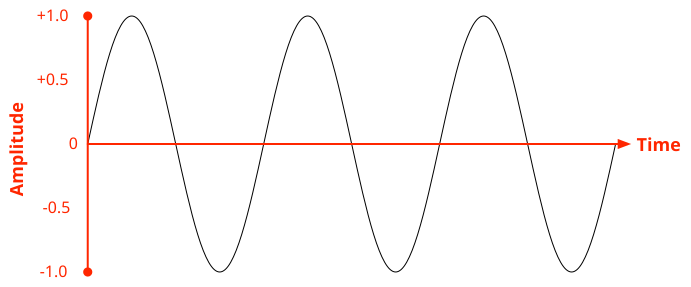
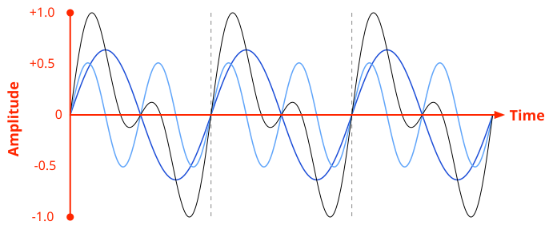
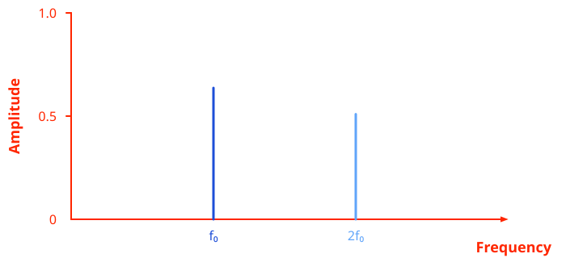
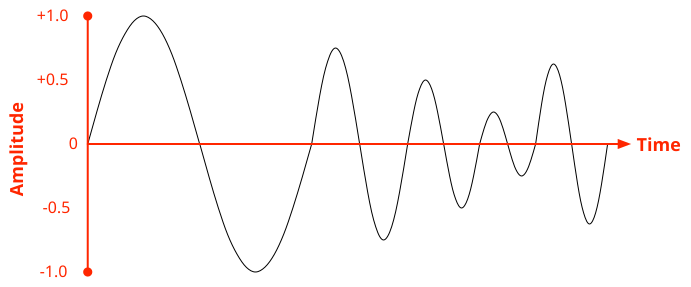
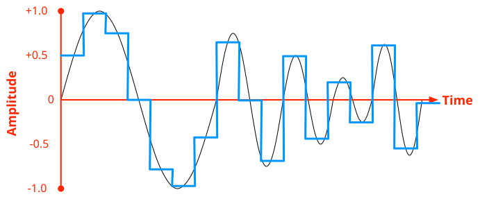
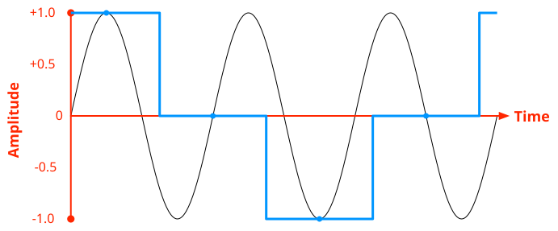
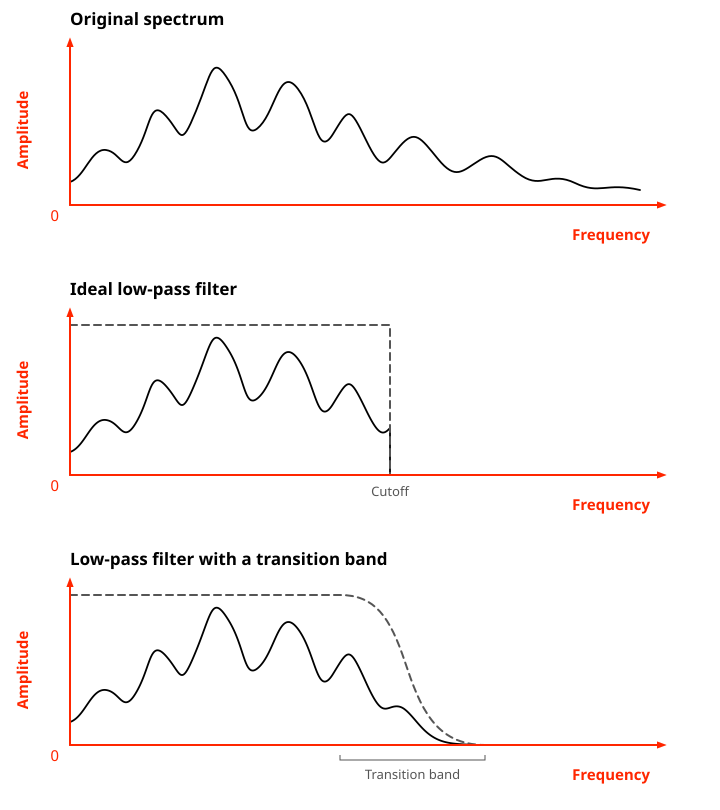
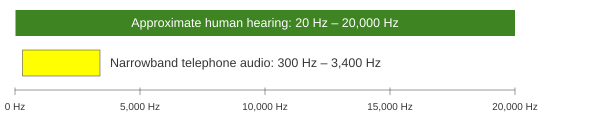

Representing audio in digital form involves a number of steps and processes, with multiple formats available both for the raw audio and the encoded or compressed audio which is actually used on the web. This guide is an overview examining how audio is represented digitally, and how codecs are used to encode and decode audio for use on the web.

## The sound wave

Sound is an inherently analog feature of the natural world. As a sound-producing object (e.g., your vocal folds or a speaker diaphragm) vibrates, it causes the surrounding molecules to vibrate. These molecules affect the ones adjacent to them, and so forth, propagating the vibration as a wave outward from the source.

These vibrating molecules form the _medium_ that the sound travels through, which can be a gas, liquid, or solid. Everyday sounds almost always travel through air before they reach your ear, but for example, [bone conduction headphones](https://en.wikipedia.org/wiki/Bone_conduction) essentially use only your bones, a solid, as the medium.

The energy from the sound source has two fates. Imagine the sound wave as a ripple traveling through the surface of some water. As the ripple's perimeter expands, more molecules vibrate; therefore, each one receives less of the available kinetic energy. Each molecule also absorbs a fraction of the received energy as heat without passing it on. Eventually, at some distance from the source, the remaining energy is so little that the sound is indistinguishable from background noise. However, a small fraction of the wave energy may reach the listener's ear while it is still detectable. The ear's inner workings pick up the wave and convert it into electrical signals that get sent to the brain.

The _sound wave_ itself is the back-and-forth displacement (vibration) pattern of each molecule in the medium, and this is the signal that gets processed by your brain. For example, here is the most basic sound wave:

This is a _sine wave_, which has two important parameters: each peak's displacement from the center point, called the _amplitude_ (measured in distance units such as meters), and the distance between two peaks, called the _period_ (measured in time units such as seconds). If you take the inverse of the period, you get the _frequency_, which is how many peaks can occur per second, measured in Hertz.

Amplitude is correlated with the loudness—the more dramatically the molecules vibrate, the louder the sound becomes at that instant. Frequency is correlated with the pitch—the more frequently the molecules vibrate, the higher the sound becomes.

Real sound waves are not this simple. Here is a more complex sound wave:

This signal is still _periodic_: there are recurring patterns, but each pattern consists of more than one peak, and the peaks have distinct amplitudes. The [Fourier theorem](https://en.wikipedia.org/wiki/Fourier_series) tells us that every periodic wave can be expressed as a sum of many sine waves, so for example we can decompose this complex wave into its component sine waves:

Here, each blue curve is a sine wave. If you add up the displacements of the blue curves at each time point, you get the black curve.

If you plot the amplitude of each component sine wave against its frequency, you get the _spectrum_ of the audio signal. For example, the two component sine waves above have frequencies f0 and 2f0, and the former has a slightly larger amplitude than the latter, so the spectrum looks like this:

We can say that this sound signal has two **frequency components**, one with frequency f0 and another with frequency 2f0. All energy is concentrated in these two particular frequencies, while all other frequencies have zero energy. Real sound signals usually have energy spread across continuous ranges of frequencies, so we can say, for example, that a sound has a **frequency band**. In the time domain, such a signal might look like this:

## Sampling audio

Sound is an analog signal. In the sound wave above, every single data point on the curve can vary continuously along the time and displacement axes. Computers, however, are digital and must use a few discrete data points to represent a wave. This process is called **analog to digital conversion** (**A/D** for short).

Just like the human ear, the microphone itself is an analog device that converts the sound wave to electric signals using voltage levels to represent the amplitude. This analog signal is sent to a circuit (called an **A/D converter**, or ADC), which records the voltage level at regular time intervals (called the **sampling period**) and stores it as a fixed-bit-size number, thus turning the continuous wave into a discrete array of amplitude levels. Each of these captured moments is a **sample**. If you assume that the sound wave jumps abruptly from one sample to the next, you get a _staircase_ approximation, shown below.

In this example, the black curve is the original analog audio waveform, and the blue curve is the approximated digital wave. The midpoint of each horizontal segment of the blue curve is an actual sample (this is also where each segment intersects the black curve). We extend each sample to the left and right by half a sampling period each, and connect these horizontal segments together to form the staircase pattern.

When playing that sound back later, these amplitudes are used with a reconstruction filter to generate a continuous approximation of the original waveform. The staircase waves generally sound unpleasant, and modern devices use filters to restore the smoothness as much as possible.

The ADC itself has several parameters that are either fixed in hardware or tunable. The first is the **sample rate**, which is the number of samples taken per second. This is the inverse of the sampling period—the farther apart two samples are, the fewer samples you take per second. We'll talk more about sample rates in [audio codecs](#sample_rates) because this can also be adjusted by the codec.

The second is the **audio bandwidth**, which defines the maximum frequency the ADC is able to capture. The codec is also capable of restricting the bandwidth. (We'll also talk more about this in [sample rates](#sample_rates).)

The third is the **gain**, which is roughly how the input amplitude is scaled to voltage levels. Higher gain gives you audio that sounds louder, but it may also create voltage levels outside the range supported by the hardware, and such voltage levels are clipped to the supported range, leading to incorrect waves.

The fourth is the **resolution**, which is how many bits encode each amplitude sample. For example, if the samples are 8-bit, that means there are 28 = 256 distinct amplitude levels that the digital signal can distinguish. This produces a small file but also really low-quality audio. Today, "8-bit" is rarely used as an actual audio resolution, but it describes a retro sound aesthetic (like pixel art).

The resolution is the audio quality's upper bound. You can start with a higher sample size and reduce it later on, but you can't, for example, produce 16-bit quality audio if your ADC only has an 8-bit resolution.

> [!NOTE]
> Like most other pieces of modern technology, audio recording today is much more complex than this introduction. For example, modern ADCs may oversample and then algorithmically convert the signal to the given sampling rate using local averaging instead of instantaneous measurements. However, this section is still useful as the basic mental model.

## Audio data format and structure

The ADC outputs an array of numbers. If you just put them into a file, you get PCM (pulse-code modulation) audio. Most audio codecs, however, are more complex. For example, you may want compression, multi-channel, or even data recovery if part of the data is lost. The software for converting the raw ADC signal into more sophisticated formats for software purposes is called an audio **{{Glossary("codec")}}** (**CO**der/**DE**coder). Over the years, many codecs have been developed, some of which are commonly used on the web. For details about the most important and useful ones for web developers to be familiar with, see the article [Guide to audio codecs used on the web](/en-US/docs/Web/Media/Guides/Formats/Audio_codecs).

### Audio channels and frames

Modern audio codecs are _multi-channel_, which means they can store multiple time-aligned parallel audio signals. For example, when you play music through your headphones, your left and right ears may hear different sounds—that's because they are stored as distinct channels. If a single signal is an array of numbers, then multi-channel audio is essentially an array of **audio frames**, where each frame is an array of `n` numbers where `n` is the **channel count**.

> [!NOTE]
> Some codecs will actually separate the left and right channels, storing them in separate blocks within their data structure. However, an audio frame is always comprised of all of the data for all available channels. The samples may be assembled by software instead of physically stored adjacently in the codec.

There are two types of audio channels. Standard audio channels present the majority of the audible sound. The sound for the left and right main channels, as well as your surround sound speakers (center, left and right rear, left and right sides, ceiling channels, and so forth), are all standard audio channels. Special **Low Frequency Effects** (**LFE**) channels provide the signal for special speakers designed to produce low-frequency sounds and vibrations designed to create a visceral sensation when listening to the audio. The LFE channels typically drive subwoofers and similar devices.

Monophonic audio has one channel, stereo sound has two channels, 5.1 surround sound has 6 channels (five standard and one LFE), and so forth. Each audio frame is a data record that contains the samples for all of the channels available in an audio signal.

### Samples

The ADC outputs integers with a given resolution; the codec then further converts them to a data type representing a specific **sample size**. Most audio files use 16-bit signed integers for each sample, but others use 32-bit floating-point values or 24-bit or 32-bit integers. The samples may be signed or unsigned.

### Sample rates

We already talked about sample rates in the context of ADCs, and the codecs themselves may also resample. The most common sample rates are:

- 8000 Hz
  - : The international [G.711](https://en.wikipedia.org/wiki/G.711) standard for audio used in telephony uses a sample rate of 8000 Hz (8 kHz). This is enough for human speech to be comprehensible.
- 44100 Hz
  - : The 44.1 kHz sample rate is used for compact disc (CD) audio. CDs provide uncompressed 16-bit stereo sound at 44.1 kHz. Computer audio also often uses this frequency by default.
- 48000 Hz
  - : The audio on DVD is recorded at 48 kHz. This is also often used for computer audio.
- 96000 Hz
  - : High-resolution audio.
- 192000 Hz
  - : Ultra-high resolution audio. Not commonly used yet, but this will change over time.

Low sample rate gives you smaller data, but it also means rapid oscillations between samples may be mistaken for a lower-frequency signal, known as [_aliasing_](https://en.wikipedia.org/wiki/Aliasing). For example, if you go back to the original sine wave diagram, and take samples like this:

Now, within one period in the blue staircase approximation, there are 3 periods of the original wave, so the blue wave only has 1/3 of the frequency of the original signal. When you play back the blue wave, you'll hear a much lower sound than the original black wave!

The [Nyquist–Shannon sampling theorem](https://en.wikipedia.org/wiki/Nyquist%E2%80%93Shannon_sampling_theorem) tells us that in order to faithfully reconstruct signals whose components go up to frequency _f_, the sample rate must be more than twice that (_2f_). Conversely, for a given sampling frequency, half of it is called the _Nyquist frequency_, which is the upper bound of the frequency in the audio spectrum that can be faithfully captured. Therefore, the sample rate you choose for the codec must have a Nyquist frequency above the maximum frequency you expect to record.

In reality, the input signal almost always contains frequency bands above the Nyquist frequency. Naïvely sampling this signal causes the high-frequency components to be aliased to low-frequency components and their wave displacements to be added together, distorting the lower-frequency components. To prevent this, before sampling (in either the ADC or the audio encoder), the signal first goes through a [low-pass filter](https://en.wikipedia.org/wiki/Low-pass_filter). The low-pass filter takes the spectrum and multiplies the amplitude at each frequency by some constant between 0 and 1, where multiplying by 1 preserves the energy, multiplying by 0 completely removes that component, and multiplying by other values attenuates the component without removing it. Ideally, you want the low-pass filter to be a "brick-wall filter" which perfectly preserves frequencies below the Nyquist frequency and perfectly removes frequencies above it, but this is infeasible in hardware, so actual low-pass filters have a [transition band](https://en.wikipedia.org/wiki/Transition_band) where the frequencies get attenuated without removal.

For example, if you want a Nyquist frequency of 20 kHz (corresponding to a sampling rate of 40 kHz), then you should make sure that the filter is close enough to 0 at 20 kHz. If the transition band is 2 kHz, then you can only expect frequencies of up to 18 kHz to be sufficiently preserved, while frequencies between 18 kHz and 20 kHz will be attenuated and lose amplitude.

This explains the common sample rates we see above:

- Traditional telephone audio carries frequencies up to about 3,400 Hz, preserving enough information for speech to remain intelligible. (This is extremely lossy, which is why "telephone voice" often sounds thin and muffled.) The 8,000 Hz sampling rate has a 4,000 Hz Nyquist frequency, leaving 600 Hz for the transition band.
- Humans can hear sounds up to 20,000 Hz. The 44.1 kHz and 48 kHz sampling rates both have Nyquist frequencies slightly above it, leaving 2.05 kHz and 4 kHz for the transition band, respectively. 48 kHz produces slightly more data, but allows a larger transition band, which possibly preserves high-frequency sounds better.
- 96 kHz and 192 kHz are technically unnecessary for reconstructing sounds that humans can meaningfully perceive. However, they allow even more room for filters and preserve components that may become audible when slowed down. They are generally used for audio mastering, where you need as much quality as possible while manipulating and editing the sound before downsampling to the sample rate you will use for the final product. This is similar to how photographers will use high resolution images for editing and compositing before presenting the customer with a JPEG suitable for use on a website.

### Audio file size and network bandwidth

On the web, the most common configuration is stereo (2 channels: left and right), 16-bit (2-byte) samples, and 48 kHz sample rate. Multiply them together, and you get how much data is sent per second, known as the **bit rate**:

<!-- prettier-ignore-start -->
<math display="block">
  <semantics><mrow><mn>2</mn><mo>×</mo><mn>2</mn><mfrac><mrow><mi>bytes</mi></mrow><mrow><mi>sample</mi></mrow></mfrac><mo>×</mo><mn>48000</mn><mfrac><mrow><mi>samples</mi></mrow><mrow><mi>second</mi></mrow></mfrac><mo>=</mo><mn>192000</mn><mfrac><mrow><mi>bytes</mi></mrow><mrow><mi>second</mi></mrow></mfrac><mo>=</mo><mn>192</mn><mi>kBps</mi></mrow><annotation encoding="TeX">2 \times 2\frac { bytes }{ sample } \times 48000\frac { samples }{ second } = 192000\frac { bytes }{ second } = 192 kBps</annotation></semantics>
</math>
<!-- prettier-ignore-end -->

At 192 kBps, lower-end networks will be strained when playing a single audio stream. If the network is also doing other things, even faster networks may run out of bandwidth. With so much competition for network capacity, especially on slower networks, this amount of data may be too much for real-time applications to viably transmit.

> [!NOTE]
> Network bandwidth (bytes per second) is obviously not the same thing as audio bandwidth (maximum recorded frequency), which is discussed in [Sampling audio](#sampling_audio), above.

You can further multiply the bit rate by the duration to get the raw audio data size. For example, a 3-minute song will take 192,000 × 180 = 34.56 MB, uncompressed. This is also unacceptably large for a web asset.

To solve this problem, the audio must be made smaller using compression.

## Audio compression basics

Unlike text and many other kinds of data, audio data tends to be **noisy**, meaning the data rarely consists of a series of exactly repeated bytes or byte sequences. As a result, audio data is difficult to compress using traditional algorithms such as those used by general-purpose tools like `zip`, which usually work by replacing repeating sequences of data with a shorthand representation.

If loss of detail and potentially fidelity is unacceptable or undesirable, a **lossless** codec is preferred. Conversely, if some degree of audio fidelity reduction is okay, a **lossy** codec can be used. Most audio codecs use lossy compression because it offers a better compression ratio. Whereas lossless compression algorithms usually output a file 40-50% of the original uncompressed size, modern lossy compression algorithms can output results between 5-20% of the original size, depending on the complexity of the audio.

Lossy codecs may lose quality and detail, but the loss is usually difficult for the average listener to discern, and the compression ratio gain far outweighs the loss in quality. Nevertheless, certain people have exceptionally good hearing, or are particularly adept at noticing the kinds of changes introduced to music by lossy compression techniques.

Researchers continue to devise better ways to analyze and compress audio, so new formats come out periodically that offer various improvements, either in compression ratio or audio fidelity (or both).

Use cases for lossless audio include scenarios such as:

- Any situation in which the listener expects precise audio reproduction and may have an ear for sound that's good enough to make out the intricate details of unaltered audio
- Audio loops and samples used in music and sound effects production work
- Situations in which audio clips or samples may be remixed and then compressed; using lossless audio for the mastering process avoids compressing previously compressed data, resulting in additional quality loss

Factors that may recommend the use of lossy compression include:

- Very large source audio
- Constrained storage (either because the storage space is small, or because there's a large amount of sound to store into it)
- A need to constrain the network bandwidth required to broadcast the audio; this is especially important for live streams and teleconferencing

If you are already familiar with [image format selection](/en-US/docs/Web/Media/Guides/Formats/Image_types), then the heuristics for selecting lossy and lossless audio codecs are not much different from those of lossy and lossless image formats (like JPEG vs. PNG).

## Psychoacoustics 101

While lossless compression is purely algorithmic (akin to zip), lossy compression needs to be very aware of how much information can be removed before it becomes obvious to the intended audience. By removing components of the sound that aren't really heard, the waveform becomes simpler, resulting in more consistent data that is easier to compress.

Because most audio is played to humans, the most commonly used lossy compression methods for audio apply the science of **[psychoacoustics](https://en.wikipedia.org/wiki/Psychoacoustics)**. This is the study of how humans perceive sound and which audio frequencies are most important to how we respond to sound, given the context and content of the sound. A codec can consider factors such as the ability to sense changes in sound frequency, the overall range of human hearing, amplitude contrast, etc.

Diving into the details of psychoacoustics and how audio compression works is far beyond the scope of this article, but a general idea of how audio gets compressed by common algorithms can help you understand and make better decisions about audio codec selection.

Overall, lossy filtering techniques can have three consequences:

- They may _improve_ the quality of the audio. For example, you can apply a filter that removes hiss and background noise, converting any quiet sections into silence and smoothing out the signal. This can produce stretches of silence and make the meaningful sounds easier to hear.
- They may _perfectly preserve_ the quality of the audio by removing signals humans can't perceive. For example, removing frequency bands above humans' hearing range.
- They may remove meaningful parts of the audio, but in a way that's irrelevant to the information being conveyed. For example, removing frequency bands above sounds typical to human speech.

The type of content being encoded can affect the choice of codec. In particular, speech codecs can take advantage of the structure of human speech. In addition, intelligible speech can be transmitted using only a portion of the range of audio frequencies the human ear can detect.

One common compression technique is reducing the audio bandwidth. When the frequency spectrum is narrower, there's less information, which lets the lossless compression algorithm do its work better. You can most effectively shrink the bandwidth by reducing the maximum frequency. A safe upper bound is to only preserve frequency bands below 20,000 Hz. Most codecs' Nyquist frequencies are already near this boundary, and this is about as far as you can go before you start losing perceivable information, but it is still a helpful start. Some people can hear outside this range to some extent. More often, people's ability to hear higher frequencies is rather lower than this; in particular, sensitivity to higher frequencies generally declines with age.

Conventional narrowband telephone systems, designed specifically to transmit human voices, carry audio from approximately 300 Hz to 3,400 Hz. This doesn't cover the entire range of human speech, but it provides enough spectral and temporal information for speech to remain intelligible in many listening conditions. So this is a well-established compromise for resource-constrained speech transmission; narrowing the band further can make speech harder to understand.

The diagram below compares the approximate frequency range of human hearing (green) to the conventional narrowband telephone band (yellow). If you drop the sampling rate from 48 kHz to 8 kHz, you essentially achieve a 6:1 compression upfront.

You can also try to tune the frequency bandwidth between these two bounds to achieve your desired compression ratio while preserving enough quality for your audience. For example, [Johnson (2012, pp. 53, 86)](https://books.google.com/books?id=sKOUKJXbmYMC) recommends a 22 kHz sampling rate for acoustic and phonetic analysis, because "human sensitivity to frequency information above 10 kHz is rather limited".

Different features of speech involve different frequency ranges, for example:

- Some aperiodic consonants, such as sibilants like the hissing "s", concentrate their energy at high frequencies: 4 kHz to 10 kHz. They are usually the first to be filtered out in the telephone range, and removing them may [impede speech recognition](https://pubmed.ncbi.nlm.nih.gov/11681394/).
- Vowels are produced by the constriction of the vocal tract, which attenuates and enhances certain bands of the frequency spectrum, creating frequency bands of concentrated energy called _formants_. The first two formants are usually enough to distinguish most vowels, which can range from 200 Hz to 3,000 Hz. Anatomical factors, such as the vocal tract length, can have an effect. Such factors are, in turn, affected by the speaker's age, gender, etc.
- The vibration frequency of the vocal folds forms the _pitch_, or _fundamental frequency_, of the voice, and it carries tone information. The fundamental frequency ranges from 80 Hz to 300 Hz, and again depends on anatomical factors affected by age and gender—children can reach as high as 600 Hz. The pitch frequency may be too low for telephone range, but higher-order overtones (harmonics) help the brain reconstruct the pitch.
- Some speech features, such as creaky voice (also called vocal fry), can go as low as 20 Hz.

Therefore, when you restrict the audio bandwidth, you must experiment with different speakers—male, female, children, elderly—on a variety of sounds to see if they remain recognizable.

On top of simplifying the sound through psychoacoustic analysis, codecs use other algorithms and transforms to further simplify and reduce the size of the audio. If you'd like to learn more about the way compression works on audio, take a look at [Audio data compression](https://en.wikipedia.org/wiki/Data_compression#Audio) on Wikipedia.

Importantly, codecs do all the hard work for you. It's why so much engineering and scientific study goes into the creation of new algorithms and codecs. All you need to do is consider the options and your use case, then choose the appropriate codec for your needs.

> [!NOTE]
> For a more detailed guide to choosing audio codecs, see [Choosing an audio codec](/en-US/docs/Web/Media/Guides/Formats/Audio_codecs#choosing_an_audio_codec).

## Lossless encoder parameters

Lossless encoders have less room to manipulate audio to improve compression rates, given the need to reproduce the original audio. This limits the number of options available to configure these encoders. The options tend to revolve around choosing a method to perform the encoding, and specifying how much time and processor power the encoder is allowed to consume in order to do so.

These parameters vary depending on the codec, but can include:

- Algorithms to use during particular phases of the encoding process
- Parameters for those algorithms to use, such as how much predictive depth to use when trying to model the audio
- The number of passes to make while analyzing the audio, or the number of times given algorithms should be run

## Lossy encoder parameters

Most codecs have input values you can tune to optimize the compression in various ways, either for size or for quality. When using a lossy encoder, the higher the quality, the larger the encoded audio will be. Because of this, most options affect both quality and size in some manner.

Refer to the documentation for the encoding software you use to determine which options are available. Some codecs have several values you can adjust (some of which may require a deep understanding of psychoacoustics and the codec's algorithms), while others offer a "quality" parameter that automatically adjusts various algorithm properties.

### Bit rate

There are two mutually-exclusive ways to control the quality of the compressed audio using the bit rate. The first involves targeting an average bit rate for the encoded data, while the second involves specifying a constant quality value to target while allowing the bit rate to vary.

#### Average bit rate

The first method for controlling output file quality is to specify the **Average Bit Rate** (**ABR**) to target when encoding the audio. The encoder will attempt to produce an encoded sound file that uses, on average, the specified number of bits for each second of audio playback. This controls quality from the perspective of the encoded audio size; the higher the bit rate, the higher the resulting audio quality will be. Audio quality will fluctuate over time as needed to meet the targeted bit rate.

Somewhat similar to ABR is **CBR** (**Constant Bit Rate**). Where ABR attempts to keep the bit rate on average at a given level, while allowing some fluctuation, CBR uses an actually fixed bit rate for the duration of the audio. CBR is primarily used in codecs designed for voice-only purposes, where the frequency range and variation tends to be minimal, allowing CBR encoding to work without unworkable fluctuations in audio quality.

#### Variable bit rate

**Variable Bit Rate** (**VBR**) encoding works by accepting as an input a **constant quality** setting. This indicates a quality level to maintain for the audio's entire duration, allowing the bit rate to fluctuate as needed to achieve that quality. In portions of the sound where compression is easily achieved with minimum impact to quality, the bit rate may be very low, while in areas where compression is more complex, the bit rate will be higher.

### Audio frequency bandwidth

Some codecs allow you to configure the audio frequency bandwidth directly, either by specifying the range of frequencies to allow, by establishing upper and/or lower frequency limits, or by specifying an audio source type that determines how to configure the algorithm based on the expected frequency use of the incoming signal.

In addition, some codecs support special limited frequency bandwidth channels, such as the LFE channel, which inherently limit the frequency range available. In the case of LFE, the audio frequency bandwidth is limited to a frequency range suitable for use by a subwoofer or similar audio experience enhancement device.

Some codecs offer special profiles which are specifically intended for particular usage scenarios, such as VoIP; these profiles may also include by default restrictions to the audio frequency bandwidth.

### Joint stereo

Stereo sound is typically represented by audio frames containing one sample per channel. This results in audio frames that require 2 times _sampleSize_ bits each, where _sampleSize_ is the number of bits each audio sample takes. Therefore, for a 16-bit stereo audio recording, each sample uses 2 times 16, or 32, bits of space. This is standard left/right (L/R) stereo or **simple stereo**.

**Joint stereo** is a method of storing stereo audio samples in a more space-efficient manner by taking into account that usually the sound entering each ear is similar. Thus, rather than storing every bit of each channel's sample, a base amplitude and a per-channel amplitude deviation value are stored, wherein the deviation value may use fewer bits than a complete sample.

There are two types of joint stereo: mid-side and intensity. Over the duration of an audio file, the encoder may change which format is being used to represent the stereo signal over the course of the audio file.

#### Mid-side stereo coding

**Mid-side stereo coding** (**MS**) works by recording frames that contain a fundamental **mid channel**, which is the average amplitude of the original left and right audio channels. This is essentially what you would calculate as the amplitude when converting a stereo signal into mono. Then you store the **side channel** value; this number is added to the **mid channel** value to determine the left channel's original amplitude, and subtracted from the mid channel value to compute the right channel's original value.

In other words, given a left channel, L, and a right channel, R, you perform the following calculations when encoding a sample:

<!-- prettier-ignore-start -->
<math display="block">
  <semantics><mrow><mi mathvariant="italic">mid</mi><mo>=</mo><mfrac><mrow><mi>L</mi><mo>+</mo><mi>R</mi></mrow><mn>2</mn></mfrac></mrow><annotation encoding="TeX">mid = \frac { L + R }{ 2 } </annotation></semantics>
</math>
<!-- prettier-ignore-end -->

<!-- prettier-ignore-start -->
<math display="block">
  <semantics><mrow><mi mathvariant="italic">side</mi><mo>=</mo><mfrac><mrow><mi>L</mi><mo>-</mo><mi>R</mi></mrow><mn>2</mn></mfrac></mrow><annotation encoding="TeX">side = \frac { L - R }{ 2 }</annotation></semantics>
</math>
<!-- prettier-ignore-end -->

Then you store the values of `mid` and `side`. While `mid` is still the same size as your sample size (such as 16 bits), the value of `side` can probably be stored in a smaller number of bits, since the amplitude of the two channels is relatively similar. The encoder can then take this smaller number of total bits per frame and perform additional computations to further reduce the size.

While decoding the audio, the absolute left and right channel values are calculated like this:

<!-- prettier-ignore-start -->
<math display="block">
  <semantics><mrow><mi>L</mi><mo>=</mo><mi mathvariant="italic">mid</mi><mo>+</mo><mi mathvariant="italic">side</mi></mrow><annotation encoding="TeX">L\quad =\quad mid\quad +\quad side</annotation></semantics>
</math>
<!-- prettier-ignore-end -->

<!-- prettier-ignore-start -->
<math display="block">
  <semantics><mrow><mi>R</mi><mo>=</mo><mi mathvariant="italic">mid</mi><mo>-</mo><mi mathvariant="italic">side</mi></mrow><annotation encoding="TeX">L\quad =\quad mid\quad -\quad side</annotation></semantics>
</math>
<!-- prettier-ignore-end -->

On its own, mid-side stereo coding is lossless, and is commonly used by both lossless and lossy audio codecs. Any loss of detail comes from other steps of the encoding process.

#### Intensity stereo coding

**Intensity stereo coding** reduces the encoded audio bit rate by taking advantage of the way humans determine the location of sounds in space; this is called [sound localization](https://en.wikipedia.org/wiki/Sound_localization).

Our ears are on opposite sides of our heads, and therefore separated by several inches. A sound coming from our right arrives at the right ear before the left; the amplitudes heard in each ear are also different. Our brains use these phase and amplitude differences to help determine where the sound is coming from. At higher frequencies, differences in audio level remain important, while sensitivity to differences in phase is reduced.

Armed with this information, we can approximately represent a stereo audio signal by merging selected higher-frequency bands into a single channel, then including information about their amplitudes only in the original channels. This requires fewer bits to represent, but is inherently somewhat lossy.

## See also

- [Guide to audio codecs used on the web](/en-US/docs/Web/Media/Guides/Formats/Audio_codecs)
