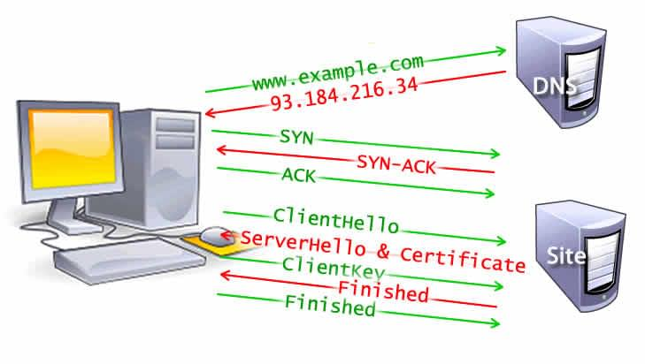
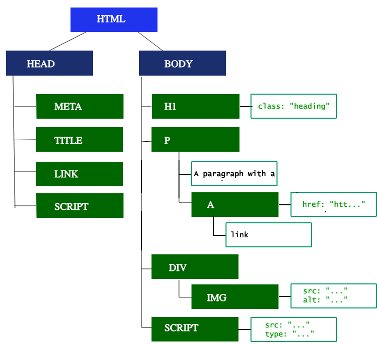
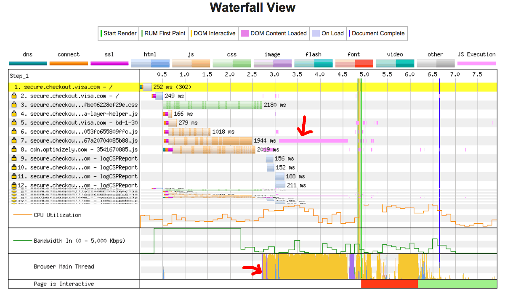

Users want web experiences with fast-loading content and smooth interactions. Developers should therefore strive to achieve these goals.

When implementing changes that improve actual and perceived performance, it helps to understand how the browser works. This article explains how the browser loads content and what affects performance.

## Overview

Fast sites provide better user experiences. Users want and expect fast-loading content and a smooth, responsive experience.

Two major issues in web performance are latency and the fact that, for the most part, browsers are single-threaded.

Latency is the biggest threat to our ability to ensure a fast-loading page. It is the developers' goal to make the site load as fast as possible — or at least _appear_ to load super fast — so the user gets the requested information as quickly as possible. Network latency is the time it takes to transmit bytes over the air to computers. Web performance is what we have to do to make the page load as quickly as possible.

For the most part, browsers are considered single-threaded. That is, they execute a task from beginning to end before starting another task. The developer needs to ensure performant site interactions, from smooth scrolling to responsive touch interactions. Render time is key — the main thread needs to complete all the work we throw at it and still be available to handle user interactions. Web performance can be improved by understanding the browser's single-threaded nature and minimizing the main thread's responsibilities to ensure smooth rendering and immediate responses.

## Navigation

_Navigation_ is the first step in loading a web page. It occurs whenever a user requests a page by entering a URL into the address bar, clicking a link, submitting a form, etc.

One goal of web performance is to minimize navigation completion time. Latency and bandwidth can cause delays.

### DNS lookup

The first step when navigating to a web page is locating the page's assets. If you navigate to `https://example.com`, the HTML page is located on a server with an IP address `93.184.216.34`. The first time you visit this site, a DNS lookup happens.

Your browser requests a DNS lookup, which is eventually fielded by a name server that responds with an IP address. After this initial request, the IP address will likely be cached. This speeds up subsequent requests because the IP address can be retrieved from the cache instead of the name server.

DNS lookups usually only need to be done once per hostname for a page load. However, DNS lookups must be done for each unique hostname the requested page references. If your fonts, images, scripts, ads, and metrics all have different hostnames, a DNS lookup is needed for each one.


This can be problematic for performance, particularly on mobile networks. When a user is on a mobile network, each DNS lookup goes from the phone to the cell tower to reach an authoritative DNS server. The distance between a phone, a cell tower, and the name server can add significant latency.

### TCP handshake

Once the IP address is known, the browser sets up a connection to the server via a {{glossary('TCP handshake','TCP three-way handshake')}}. This mechanism is designed so that two entities attempting to communicate — in this case the browser and web server — can negotiate the parameters of the network TCP socket connection before transmitting data, often over {{glossary('HTTPS')}}.

TCP's three-way handshake is often referred to as "SYN-SYN-ACK" — or more accurately SYN, SYN-ACK, ACK — because TCP transmits three messages to negotiate and start a TCP session between two computers before the request is even made.

### TLS negotiation

For secure connections established over HTTPS, another "handshake" is required. This handshake, or rather the {{glossary('TLS')}} negotiation, determines which cipher is used to encrypt the communication, verifies the server, and establishes that a secure connection is in place before beginning data transfer. This requires five more round trips to the server before sending the content request.



Making the connection secure adds time to the page load, but it is worth the latency expense, as a third party cannot decrypt the data transmitted between the browser and the web server.

After eight round trips to the server, the browser can finally make the request.

## Response

Once a connection is established with a web server, the browser sends an initial [HTTP `GET` request](/en-US/docs/Web/HTTP/Reference/Methods) on behalf of the user, which for websites is most often an HTML file. Once the server receives the request, it replies with relevant response headers and the HTML content.

```html
<!doctype html>
<html lang="en-US">
  <head>
    <meta charset="UTF-8" />
    <title>My simple page</title>
    <link rel="stylesheet" href="styles.css" />
    <script src="myscript.js"></script>
  </head>
  <body>
    <h1 class="heading">My Page</h1>
    <p>A paragraph with a <a href="https://example.com/about">link</a></p>
    <div>
      
    </div>
    <script src="another-script.js"></script>
  </body>
</html>
```

This response for this initial request contains the first byte of data received. {{glossary('Time to First Byte')}} (TTFB) is the time between when the user made the request — say by clicking on a link — and the receipt of this first packet of HTML. The first chunk of content is usually 14KB of data.

In our example above, the request is definitely less than 14KB, but the linked resources aren't requested until the browser encounters the links during parsing, as described below.

### Congestion control / TCP slow start

TCP splits data into segments for transmission and guarantees the reliable delivery of all segments between server and client. The client acknowledges received segments by sending ACK packets, and the server decides what number of segments to send before waiting for an ACK.

This number must provide a balance — if the server waits for an ACK after each segment, the transfer will be slow because the server has to wait a full round trip for every sent segment, even on a low-load network.
On the other hand, sending too many segments at once into a busy network may cause some of them to be dropped along the way. The client can't acknowledge segments it never received, so the server eventually re-sends them.

TCP uses two separate limits on how much unacknowledged data the server can have in flight:

- The _receive window_ (RWND) protects the client: it tells the server how much incoming data the client is currently prepared to accept. This limit is related to the available space in the client's receive buffer, and the client advertises it to the server to provide TCP flow control.
- The _congestion window_ (CWND) protects the network: it is the server's estimate of how much data the path to the client can carry without segments being dropped.

The server never has more unacknowledged data in flight than the smaller of these two windows.

The congestion window starts small and is adjusted as the transfer proceeds. During {{glossary('TCP slow start')}}, it grows rapidly, roughly doubling every round trip, until segments start being dropped or the TCP slow-start threshold (`ssthresh`) is reached. After that, it grows more slowly and is reduced whenever the network shows signs of congestion. For more details about TCP congestion control, see [RFC 5681](https://www.rfc-editor.org/rfc/rfc5681.html).

## Parsing

Once the browser receives the first chunk of data, it can begin parsing the information received. {{glossary('parse', 'Parsing')}} is the step the browser takes to turn the data it receives over the network into the {{glossary('DOM')}} and {{glossary('CSSOM')}}, which is used by the renderer to paint a page to the screen.

The DOM is the browser's internal representation of the markup. The DOM is also exposed and can be manipulated through various JavaScript APIs.

Even if the requested page's HTML is larger than the initial 14KB packet, the browser will begin parsing and attempt to render content based on the data it has. It's therefore important for web performance optimization to include everything the browser needs to start rendering a page, or at least the HTML and CSS template for the basic page structure, in the first 14KB. But before anything is rendered to the screen, the HTML, CSS, and JavaScript have to be parsed.

### Building the DOM tree

We describe five steps in the [critical rendering path](/en-US/docs/Web/Performance/Guides/Critical_rendering_path).

The first step is processing the HTML markup and building the DOM tree. HTML parsing involves [tokenization](/en-US/docs/Web/API/DOMTokenList) and tree construction. HTML tokens include start and end tags, attribute names, and values. If the document is well-formed, parsing it is straightforward and faster. The parser parses tokenized input into the document, building up the document tree.

The DOM tree describes the document content. The [`<html>`](/en-US/docs/Web/HTML/Reference/Elements/html) element is the first element and root node of the document tree. The tree reflects the relationships and hierarchies between different elements. Elements nested within other elements are child nodes. The more DOM nodes, the longer it takes to construct the DOM tree.



When the parser finds non-blocking resources, such as an image, the browser will request those resources and continue parsing. Parsing can continue when a CSS file is encountered, but `<script>` elements — particularly those without an [`async`](/en-US/docs/Web/JavaScript/Reference/Statements/async_function) or `defer` attribute — block rendering and pause the parsing of HTML. Though the browser's preload scanner mitigates render blocking, large scripts can still cause a significant bottleneck.

### Preload scanner

Building the DOM tree occupies the main thread. The _preload scanner_ parses the available content and requests high-priority resources like CSS, JavaScript, and web fonts. Thanks to the preload scanner, we don't have to wait until the parser finds a reference to an external resource to request it. It retrieves resources in the background so that, by the time the main HTML parser reaches the requested assets, they may already be in flight or downloaded, thereby reducing blockages.

```html
<link rel="stylesheet" href="styles.css" />
<script src="my-script.js" async></script>

<script src="another-script.js" async></script>
```

In this example, while the main thread parses the HTML and CSS, the preload scanner finds the scripts and image and starts downloading them as well. The `async` attribute ensures the script doesn't block the process. This can be swapped out for the `defer` attribute if JavaScript parsing and execution order is important.

Waiting to obtain CSS doesn't block HTML parsing or downloading, but it does block JavaScript because scripts are often used to query CSS properties' impact on elements.

### Building the CSSOM tree

The second step in the critical rendering path is processing CSS and building the CSSOM tree. The CSS object model is similar to the DOM. The DOM and CSSOM are both trees. They are independent data structures. The browser converts CSS rules into a style map; this includes a tree of nodes with parent, child, and sibling relationships based on the CSS selectors.

As with HTML, the browser converts the received CSS rules into something it can work with. Hence, it repeats the HTML-to-object process, but for the CSS.

The CSSOM tree includes styles from the user agent style sheet. The browser begins with the most general rule applicable to a node and recursively refines the computed styles by applying more specific rules. In other words, it cascades the property values.

Building the CSSOM is fast and is not displayed in the developer tools.
Rather, the "Recalculate Style" metric in developer tools shows the total time it takes to parse CSS, construct the CSSOM tree, and recursively calculate computed styles. There are better ways to invest your time in performance optimization: creating the CSSOM generally takes less time than one DNS lookup.

### Other processes

#### JavaScript compilation

While CSS is being parsed and the CSSOM created, other assets, including JavaScript files, are downloading (thanks to the preload scanner). JavaScript is parsed, compiled, and interpreted. The scripts are parsed into abstract syntax trees. Some browser engines take the [abstract syntax trees](https://en.wikipedia.org/wiki/Abstract_Syntax_Tree) and pass them into a compiler, outputting bytecode. This is known as JavaScript compilation. Most of the code is interpreted on the main thread, with exceptions such as code run in [web workers](/en-US/docs/Web/API/Web_Workers_API).

#### Building the accessibility tree

The browser also builds an [accessibility](/en-US/docs/Learn_web_development/Core/Accessibility) tree that assistive devices use to parse and interpret content. The accessibility object model (AOM) is like a semantic version of the DOM. The browser updates the accessibility tree and the DOM at the same time. Assistive technologies cannot directly modify the accessibility tree.

Until the AOM is built, the content is not accessible to [screen readers](/en-US/docs/Web/Accessibility/ARIA/Guides/Screen_Reader_Implementors).

## Render

Rendering steps include style, layout, paint, and in some cases compositing. The CSSOM and DOM trees created in the parsing step are combined into a render tree, which is then used to compute the layout of every visible element painted to the screen. In some cases, content can be promoted to its own layer and composited, improving performance by painting portions of the screen on the GPU instead of the CPU, freeing up the main thread.

### Style

The third step in the critical rendering path is combining the DOM and CSSOM into a render tree. The computed style tree, or render tree, construction starts with the root of the DOM tree, traversing each visible node.

Elements that aren't going to be displayed, like the [`<head>`](/en-US/docs/Web/HTML/Reference/Elements/head) element and its children and any nodes with `display: none`, such as the `script { display: none; }` you will find in user agent stylesheets, are not included in the render tree as they will not appear in the rendered output. Nodes with `visibility: hidden` applied are included in the render tree, as they do take up space. As we have not given any directives to override the user agent default, the `script` node in our code example above will not be included in the render tree.

Each visible node has its CSSOM rules applied. The render tree holds all the visible nodes with content and computed styles — matching up all the relevant styles to every visible node in the DOM tree, and determining, based on the [CSS cascade](/en-US/docs/Web/CSS/Guides/Cascade/Introduction), what the computed styles are for each node.

### Layout

The fourth step in the critical rendering path is running layout on the render tree to compute each node's geometry. _Layout_ is the process by which the dimensions and location of all the nodes in the render tree are determined, plus the determination of the size and position of each object on the page. _Reflow_ is any subsequent size and position determination of any part of the page or the entire document.

Once the render tree is built, layout commences. The render tree identifies which nodes are displayed (even if invisible) along with their computed styles, but not the nodes' dimensions or location. To determine the exact size and position of each object, the browser starts at the root of the render tree and traverses it.

On the web page, almost everything is a box. Different devices and different desktop preferences mean an unlimited number of differing viewport sizes. In this phase, the browser determines the sizes of all different boxes on the screen, considering the viewport size. Layout generally starts with the body, laying out the sizes of all the body's descendants and providing placeholder space for replaced elements with unknown dimensions such as our image.

The first time the size and position of each node is determined is called _layout_. Subsequent recalculations of _layout_ are called _reflows_. In our example, suppose the initial layout occurs before the image is returned. Since we didn't declare the image dimensions, there will be a reflow once the dimensions are known.

### Paint

The last step in the critical rendering path is painting the individual nodes to the screen, the first occurrence of which is called the [first Meaningful Paint](/en-US/docs/Glossary/First_meaningful_paint). In the painting or rasterization phase, the browser converts each box calculated in the layout phase to actual pixels on the screen. Painting involves drawing every visual part of an element to the screen, including text, colors, borders, shadows, and replaced elements like buttons and images. The browser needs to do this super quickly.

To ensure smooth scrolling and animation, everything occurring on the main thread — including calculating styles and reflow and paint — must take the browser less than 16.67ms. At 2048 x 1536, the iPad has over 3,145,000 pixels to be painted to the screen. A lot of pixels need to be painted very quickly. To ensure faster repainting than the initial paint, drawing to the screen is generally broken down into several layers, which requires compositing.

Painting can break the elements in the layout tree into layers. Promoting content into layers on the GPU (instead of the main thread on the CPU) improves paint and repaint performance. Some specific properties and elements instantiate a layer, including [`<video>`](/en-US/docs/Web/HTML/Reference/Elements/video) and [`<canvas>`](/en-US/docs/Web/HTML/Reference/Elements/canvas), and any element which has the CSS properties of {{cssxref("opacity")}}, a 3D {{cssxref("transform")}}, {{cssxref("will-change")}}, and a few others. These nodes and their descendants will be painted onto their own layer unless a descendant is put on its own layer for one (or more) of the above reasons.

Layers improve performance but are expensive in terms of memory management; they shouldn't be overused as part of web performance optimization strategies.

### Compositing

When sections of the document are drawn in different overlapping layers, compositing is necessary to ensure they are drawn to the screen in the right order and the content renders correctly.

As the page continues to load assets, reflows can happen (recall our example image that arrived late). A reflow sparks a repaint and a re-composite. Had we defined our image dimensions, no reflow would have been necessary, and only the layer that needed repainting would be repainted and composited if necessary. But we didn't include the image dimensions! When the image is obtained from the server, the rendering process goes back to the layout steps and restarts from there.

## Interactivity

Once the main thread has painted the page, you would think the process is finished. That isn't necessarily the case. If the load includes JavaScript that was correctly deferred and only executed after the [`onload`](/en-US/docs/Web/API/Window/load_event) event fires, the main thread might be busy and not available for scrolling, touch, and other interactions.

{{glossary('Time to Interactive')}} (TTI) is the measurement of how long it took from that first request, which led to the DNS lookup and TCP connection, to when the page is interactive. Interactive is the point in time after the {{glossary('First Contentful Paint')}} when the page responds to user interactions within 50ms. If the main thread is parsing, compiling, and executing JavaScript, it is not available and cannot respond to user interactions in a timely manner (less than 50ms).

In our example, say the image loaded quickly, but the `another-script.js` file was 2MB, and our user's network connection was slow. In this case, the user would see the page quickly, but couldn't scroll without jank until the script was downloaded, parsed, and executed. That is not a good user experience. Avoid occupying the main thread, as demonstrated in this WebPageTest example:



In this example, JavaScript execution took over 1.5 seconds, and the main thread was fully occupied that entire time, unresponsive to click events or screen taps.

## See also

- [Web Performance](/en-US/docs/Web/Performance)
