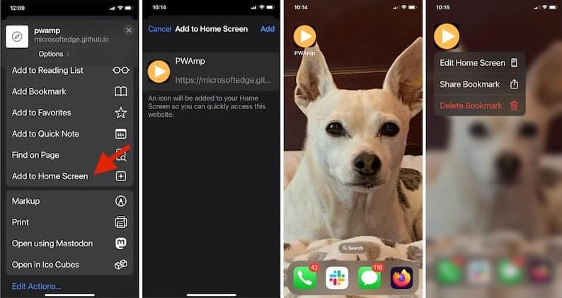
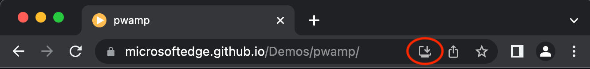
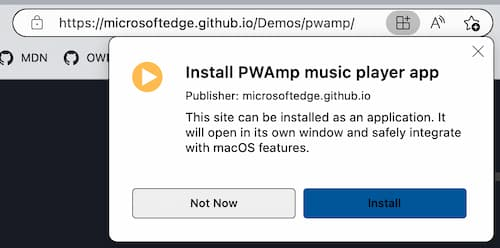
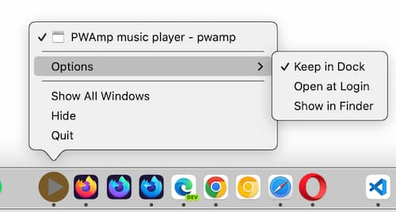
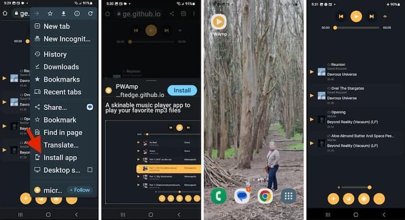
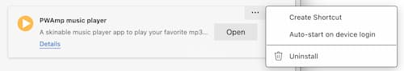

This guide looks at the concepts behind [Progressive Web Application (PWA)](/en-US/docs/Web/Progressive_web_apps) installation, including the some history, and the mechanisms browsers provide for users to install and uninstall PWAs.

If you want to learn how to make a web app installable as a PWA, see [Making PWAs installable](/en-US/docs/Web/Progressive_web_apps/Guides/Making_PWAs_installable) and [Trigger installation from your PWA](/en-US/docs/Web/Progressive_web_apps/How_to/Trigger_install_prompt).

## History of web app installation

Browsers have always enabled saving shortcuts to websites, known as "bookmarking." These are just links to websites.

Some operating systems (OS) have enhanced bookmarking capabilities, enabling saving bookmarks to common places, such as the home screen or taskbar, with an icon launching the site in the OS's default browser. For many websites, this is also just a link to the site. If the site is a PWA, saving to home screen installs the PWA on the user's device, fully integrating it into the operating systems like native applications on most devices. Just like PWAs can be installed, they can also be uninstalled.

We'll first cover the precursors — saving links to websites.

### Bookmarking websites

All browsers have add-to-favorites bookmark functionality. A bookmark, or favorite, is a clickable shortcut for a web page. Bookmarks enable quick access to websites without the user having to enter a URL or otherwise search for content. Bookmarking is especially useful for long URLs and accessing frequently visited content that is not the site's homepage.

All browsers enable users to view and manage their bookmarks, including renaming and deleting favorites. By default, the bookmark's display includes the text content of the bookmarked page's {{HTMLElement("title")}} element along with an icon consisting of the site's [favicon](/en-US/docs/Glossary/Favicon).

Browsers enable saving, editing, moving, deleting, and otherwise managing bookmarks. The UI for bookmark management differs by browser.

### Add to home screen

Smartphones, starting with the iPhone in 2007, added "save to home screen" functionality. For regular (non-PWA) websites, this feature is similar to bookmarks, but instead of adding the favicon and title of the page to the bookmarks menu — a browser feature — favoriting in this manner [adds an icon](/en-US/docs/Learn_web_development/Core/Structuring_content/Webpage_metadata#adding_custom_icons_to_your_site) to the OS's home screen.

Adding a non-PWA site to the home screen does not install the website on the device. Rather, it adds a developer-defined icon to the home screen that when clicked, opens the bookmarked link in the default browser.

If the site added to the home screen is a PWA, the PWA will be installed on the device.

Deleting the icon from the home screen removes the bookmark. The deletion confirmation provides information as to whether deleting the icon deletes a bookmark or entire application.

## Installing PWAs

While installing a PWA only takes a couple of clicks, the result of installing it may go well beyond creating a link pointing to its URL.

Depending on the PWA, device, and features of the operating system and browser, installing a PWA may enable native-like features such as giving the app its own standalone window or registering it as a file handler, more deeply integrating it with the user's device.

### The browser chrome installation UI

The browser chrome user interface for installing PWAs differs by device and OS combination.

- The "Add to home screen" user interface installs a PWA on Safari on iOS.
- Other browsers, including Chrome for Android, include the app installation command in the browser settings menu.
- In Chrome and Edge on desktop, when the user navigates to the page, if the page is a PWA and the PWA is not currently installed by the browser, an installation icon will be visible in the URL bar:

  

> [!NOTE]
> You can include PWA install buttons inside web app UIs using the {{domxref("Navigator.install()")}} method and the {{htmlelement("install")}} element. These features aim to provide more flexibility over the PWA install process, and more consistency across browsers and platforms. See [Trigger installation from your PWA](/en-US/docs/Web/Progressive_web_apps/How_to/Trigger_install_prompt) for more details.

### The install prompt

When the user starts the process of installing a PWA, the browser displays a prompt asking if they want to install the PWA, and if they accept, the PWA is installed. For example, the prompt looks like this in Edge:

Once installed, the PWA will behave like other applications that are installed on the OS. For example, on macOS, the icon will appear in the dock, and will have the same icon options as other applications:

On most desktop browsers, the install prompt is in the URL bar. On mobile, the install prompt is generally found in the browser options menu. No matter the browser or OS, the installation needs to be confirmed.

### Post-installation

Once installed, the PWA behaves just like other installed applications: clicking on the application icon opens the PWA, even when the user is offline.

When an installed PWA is launched, it can be displayed in its own standalone window, without the full browser UI, although that depends on the way the developer configured the [web app manifest](/en-US/docs/Web/Progressive_web_apps/Manifest). In any case, it still effectively runs in a browser window, even if the usual browser UI elements such as the address bar and back button aren't visible. The application will be found in the same specific folder where the OS saves other applications.

PWAs installed by a browser remain specific to that browser. This means that the browser used to install a PWA is the one used to run that PWA. If you install the same PWA using multiple browsers, the different instances will behave like separate apps and will not share any data.

The browser used to install the PWA will know the PWA is installed, but other browsers will not have access to the installed status. For example, if you install a PWA using MS Edge, Edge will prompt you to open the PWA when you visit the site while Chrome will continue to prompt you to install the application.

### Browser support notes

Installation is supported on all modern desktop and mobile devices, but supports differs by browser. Most browsers support installing PWAs on all operating systems—ChromeOS, macOS, Windows, Android, Linux, etc.—directly or when an extension is installed.

Firefox desktop requires a [PWA extension](https://addons.mozilla.org/en-US/firefox/addon/pwas-for-firefox/).

Before macOS 14 (Sonoma), PWAs could be installed on macOS from any browser **except** Safari. The opposite is true for iOS versions before 16.4, where PWAs could **only** be installed in Safari. PWAs can be installed on macOS 14.0 or later and iOS/iPadOS 16.4 or later from any supporting browser.

## Uninstalling

On most mobile operating systems, uninstalling a PWA is accomplished in the same way as uninstalling other applications. On some mobile operating systems, PWAs appear in the same control panel as applications installed from app stores, and can be uninstalled there.

On iOS, PWAs installed from Safari are listed and searchable from the "App Library" screen, but are not listed along with other installed applications under "Settings". Long tapping an icon surfaces the delete bookmark UI; removing the icon from the home screen deletes the PWA.

In some desktop operating systems, uninstalling a PWA can be done directly from the opened PWA. To uninstall:

1. Open the PWA.
2. In the top-right corner of the opened app, there will be an icon that will show more tools — click this.
3. Depending on the browser used to install the PWA, there will either be a link to uninstall the PWA, or a settings link that opens the browser's settings page with an uninstall link. Use the available mechanism to uninstall the PWA.

For example, in Edge, selecting app settings from the more tools menu opens the `edge://apps` tab. This provides a list of installed applications with options for each, including `🗑️ Uninstall`.

In Chrome, the list of Google Apps and installed PWAs is viewable by visiting `chrome://apps`.

## See also

- [Using PWAs in Chrome: computer and Android](https://support.google.com/chrome/answer/9658361)
- [Install, manage, or uninstall apps in Microsoft Edge](https://support.microsoft.com/en-us/edge/install-manage-or-uninstall-apps-in-microsoft-edge)
