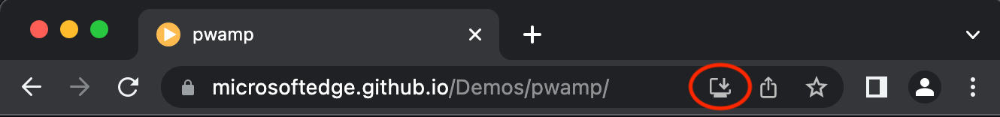
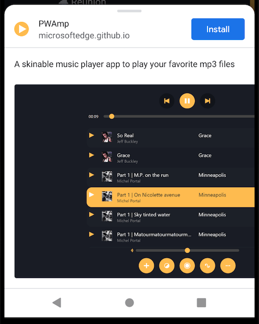

One of the defining aspects of a PWA is that it can be installated on the device, like a platform-specific app. Once installed, a PWA appears to users on their device with its own icon on the homescreen, and they can launch it directly from the operating system in its own distinct window (rather than in a browser tab), like any other standalone app. To make a web app [installable](#installability), we need to follow a few steps, after which it can be [installed directly from web UI](#installation-from-web-ui) and [browser chrome](#installation_from_browser_chrome), or packaged and [made available in an app store](#installation-from-an-app-store).

In this guide, we'll discuss the important aspects of making PWAs installable, and summarize the installation options.

## Installability

For a web app to be installable in a supporting browser, it needs to meet some technical requirements. We can consider these the minimum requirements for a web app to be a PWA.

> [!NOTE]
> While not a requirement for a PWA to be installable, many PWAs use [service workers](/en-US/docs/Web/API/Service_Worker_API) to provide an offline experience.
> See the [CycleTracker: Service workers](/en-US/docs/Web/Progressive_web_apps/Tutorials/CycleTracker/Service_workers) tutorial for more information.

### The web app manifest

A web app manifest is a JSON file that tells the browser how the PWA should appear and behave on the device. For a web app to be a PWA it must be installable, and for it to be installable it must include a manifest.

The manifest is included using a {{HTMLElement("link")}} element in the app's HTML:

```html
<!doctype html>
<html lang="en">
  <head>
    <link rel="manifest" href="manifest.json" />
    <!-- ... -->
  </head>
  <body></body>
</html>
```

If the PWA has more than one page, every page must reference the manifest in this way.

The manifest contains a single JSON object containing a collection of members, each of which defines some aspect of the PWA's appearance or behavior. Here's a rather minimal manifest, containing just two members: `"name"` and `"icons"`.

```json
{
  "name": "My PWA",
  "icons": [
    {
      "src": "icons/512.png",
      "type": "image/png",
      "sizes": "512x512"
    }
  ]
}
```

> [!NOTE]
> Chrome for desktop and Android, Safari for desktop, and Edge for desktop also support users installing _any_ website as an app, whether or not it has a manifest file. However, using a manifest file is advised: a wider variety of browsers can install the app, the browser chrome and web UI can provide more intuitive installation mechanisms, and developers can customize installation behavior.

#### Required manifest members

Chromium-based browsers, including Google Chrome, Samsung Internet, and Microsoft Edge, require that the manifest includes the following members:

- [`name`](/en-US/docs/Web/Progressive_web_apps/Manifest/Reference/name) or [`short_name`](/en-US/docs/Web/Progressive_web_apps/Manifest/Reference/short_name)
- [`icons`](/en-US/docs/Web/Progressive_web_apps/Manifest/Reference/icons) must contain a 192px and a 512px icon
- [`start_url`](/en-US/docs/Web/Progressive_web_apps/Manifest/Reference/start_url)
- [`display`](/en-US/docs/Web/Progressive_web_apps/Manifest/Reference/display) and/or [`display_override`](/en-US/docs/Web/Progressive_web_apps/Manifest/Reference/display_override)
- [`prefer_related_applications`](/en-US/docs/Web/Progressive_web_apps/Manifest/Reference/prefer_related_applications) must be `false` or not present

Though not required, it is recommended that app manifests specify an [`id`](/en-US/docs/Web/Progressive_web_apps/Manifest/Reference/id) field. This is best practice: see [Always include an `id`](/en-US/docs/Web/Progressive_web_apps/Manifest/Reference/id#always_include_an_id).

For a full description of every member, see the [Web app manifest](/en-US/docs/Web/Progressive_web_apps/Manifest) reference documentation.

### HTTPS, localhost, or loopback are required

For a PWA to be installable it must be served using the `https` protocol, or from a local development environment using `localhost` or `127.0.0.1` — with or without a port number.

This is a more stringent requirement than [secure context](/en-US/docs/Web/Security/Defenses/Secure_Contexts), which considers resources loaded from `file://` URLs to be secure.

## Installation from web UI

When a web app meets the installability criteria described earlier, you can implement an install button directly in your app's UI that users can press to open the install prompt. This is by far the most intuitive way to provide installation functionality for your users — it enables a PWA to provide some context and a reason for the user to install the PWA, and can help make the install flow easier to discover and more consistent across browsers.

Distributing your PWA as a website also means it is discoverable through web search and, if a user encounters your PWA using a browser that can't install it, they can use it just like a normal website.

There are a couple of different ways to create an install button in the web UI:

- The {{domxref("Navigator.install()")}} method and the {{htmlelement("install")}} element provide programmatic and declarative mechanisms for a developer to create their own PWA install buttons, either to directly install the current website as a PWA, or to install other apps as part of an suite of apps or a homegrown app store. The `<install>` element is the easiest method, requiring no JavaScript for the basic installation. The `install()` method can be used if you don't want to use the default browser-provided install button and want to opt for a more customized install UI.
- The [`beforeinstallprompt`](/en-US/docs/Web/API/Window/beforeinstallprompt_event) event is fired on the global [`Window`](/en-US/docs/Web/API/Window) object as soon as the browser has determined that the PWA is installable. This event has a [`prompt()`](/en-US/docs/Web/API/BeforeInstallPromptEvent/prompt) method that shows the install prompt. You can call `prompt()` from inside your own custom install button to trigger installing the site as a PWA. The `beforeinstallprompt` event is an older mechanism that is less intuitive than `install()` or `<install>`, and should only be used as a fallback for non-supporting browsers.

For more information on using these features, see our [Trigger installation from your PWA](/en-US/docs/Web/Progressive_web_apps/How_to/Trigger_install_prompt) how-to.

## Installation from browser chrome

Installable web apps will also be made available for installation in the browser chrome UI. This is somewhat less discoverable and intuitive than having an install button available in the web UI, but it is a useful default that will be available even if the developer doesn't provide an install button.

The exact nature of the browser chrome install UI varies by browser and platform. For example, a browser might include an "Install" icon in the URL bar when the user navigates to the page:



When the user selects the icon, the browser displays a prompt asking if they want to install the PWA, and if they accept, the PWA is installed.

The prompt displays the name and icon for the PWA, taken from the [`name`](/en-US/docs/Web/Progressive_web_apps/Manifest/Reference/name) and [`icons`](/en-US/docs/Web/Progressive_web_apps/Manifest/Reference/icons) manifest members.

Support for browser chrome installation varies by browser and by platform.

- On desktop:
  - Chromium browsers support installing PWAs that have a manifest file on all supported desktop operating systems.
  - Safari supports Add to Dock (_File_ > _Add to Dock..._) on macOS Sonoma (Safari 17) and later for any web app with or without a manifest file.
  - Firefox does not support installing PWAs using a manifest file.
- On mobile:
  - On Android:
    - The only browsers that [install PWAs as WebAPKs](https://web.dev/learn/pwa/installation#webapks) are Chrome on devices with Google Mobile Services (GMS), and Samsung Internet on Samsung devices.
      This gives them a real entry in the app launcher and switcher, and in the system settings.
    - Firefox, Edge, Opera, and Chrome/Samsung Internet (on devices without GMS) instead add a browser-badged homescreen shortcut that opens the site in the browser.
  - On iOS 16.3 and earlier, PWAs can only be installed with Safari.
  - On iOS 16.4 and later, PWAs can be installed from the Share menu in Safari, Chrome, Edge, Firefox, and Orion.

## Installation from an app store

Users expect to find apps in the app store for their platform, like the Google Play Store or the Apple App Store, therefore it is a good idea to make your PWAs available there to further improve visibility.

Your app must meet the installability prerequisites. The process for packaging and distribution through app stores is specific to each app store:

- [How to publish a PWA to the Google Play Store](https://chromeos.dev/en/publish/pwa-in-play)
- [How to publish a PWA to the Microsoft Store](https://learn.microsoft.com/en-us/microsoft-edge/progressive-web-apps/how-to/microsoft-store)
- [How to publish a PWA to the Meta Quest Store](https://developers.meta.com/vr/resources/publish-submit/)

The [PWABuilder](https://docs.pwabuilder.com/#/builder/quick-start) tool simplifies the process of packaging and publishing a PWA for various app stores. It supports the Google Play Store, Microsoft Store, Meta Quest Store, and iOS App Store.

If you have added your app to the app store, users can install it from there, just like a platform-specific app.

> [!NOTE]
> It is possible for developers to create their own app catalog that includes install buttons for different apps using the {{domxref("Navigator.install()")}} method and the {{htmlelement("install")}} element (see [Installation from web UI](#installation_from_web_ui)).

## Customizing the installation prompt

By default, the installation prompt contains the name and icon for the PWA. If you provide values for the [`description`](/en-US/docs/Web/Progressive_web_apps/Manifest/Reference/description) and [`screenshots`](/en-US/docs/Web/Progressive_web_apps/Manifest/Reference/screenshots) manifest members, then, on Android only, these values will be shown in the install prompt, giving the user extra context and motivation to install the PWA.

The screenshot below shows what the install prompt for the [PWAmp demo](https://github.com/MicrosoftEdge/Demos/tree/main/pwamp) looks like on Google Chrome, running on Android:



## Launching the app

Once a PWA is installed, its icon is shown on the device alongside any other apps that the user has installed, and clicking the icon launches the app.

You can use the [`display`](/en-US/docs/Web/Progressive_web_apps/Manifest/Reference/display) manifest member to control the _display mode_: that is, how the PWA appears when it is launched. In particular:

- `"standalone"` indicates that the PWA should look and feel like a platform-specific application, with no browser UI elements.
- `"browser"` indicates that the PWA should be opened as a new browser tab or window, just like a normal website.

If the browser does not support a given display mode, `display` will fall back to a supported display mode according to a predefined sequence. The [`display_override`](/en-US/docs/Web/Progressive_web_apps/Manifest/Reference/display_override) enables you to redefine the fallback sequence.
